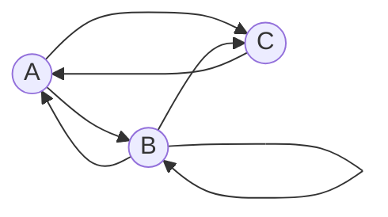

# Задание №7

## Маршруты в ориентированном графе и взаимные рекуррентные соотношения

### Вариант 3:

Дан ориентированный граф:

Маршрут длины $n$ — это последовательность из $n$ дуг графа; прохождение
петли также считается одним шагом. Найдите количество различных маршрутов
длины $n$, которые начинаются и заканчиваются в вершине $C$.  

### Решение:

Для заданного графа, для каждой вершины, учитывая из каких вершин можно придти в текущую которую сейчас рассматриваем, опишем уравнениями количества маршрутов длины $n$ начинающихся в вершине $C$ и заканчивающихся в текущей вершине относительно количества маршрутов длины $n-1$ начинающихся в вершинах $A, B$ и $С:$

$$
\begin{cases}  
 A_n = B_{n-1} + C_{n-1}\\
 B_n = A_{n-1} + B_{n-1}\\
 C_n = A_{n-1} + B_{n-1}
\end{cases}  
$$

Опишем для каждой вершины количество маршрутов длиной $1$ начинающихся в вершине $C$ и заканчивающихся в текущей вершине $:$  
$A_1 = 1$  
$B_1 = 0$  
$C_1 = 0$  

Заметим, что $:$  
$B_n = C_n$

Значит и  
$B_{n-1} = C_{n-1}$  

Подставим в уравнение $A_n:$  
$A_n = 2 \cdot C_{n-1}$

Тогда  
$A_{n-1} = 2 \cdot C_{n-2}$

Подставим $B_{n-1} = C_{n-1}$ и только что выраженное выражение для  $A_{n-1}$ относительно $C_{n-2}$ в формулу $C_n = A_{n-1} + B_{n-1}:$  

$C_n = 2 \cdot C_{n-2} + C_{n-1}$

Получим линейное  однородное рекуррентное соотношение с постоянными коэффициэнтами глубиной $2$

Составим характеристическое уравнение для полученного рекуррентного соотношения $:$

$\lambda^n = 2 \cdot \lambda^{n-2} + \lambda^{n-1}$

Поделим на $\lambda^{n-2}$

$\lambda^2 = 2 + \lambda$

Получим квадратное уравнение $:$

$\lambda^2 - \lambda -2 = 0$

Решаем уравнение $:$  
Применяем теорему Виета $:$  

$$  
\begin{cases}  
\lambda_1 + \lambda_2 = 1  \\
\lambda_1 * \lambda_2 = -2  \
\end{cases}
$$  

$\lambda_1 = 2$  
$\lambda_2 = -1$

Обратим внимание, что корни не равны, тогда $C_n$ можно выразить формулой $:$

$C_n=A_1 \cdot 2^n + A_2 \cdot (-1)^n$

Определим начальные условия, количества маршрутов длиной $1$ и $2$ начинающихся и заканчивающихся в вершине $C$.  
Очевидно, что для заданного в условии графа $:$  
$C_1 = 0$  ( Нет маршрутов длины $1$ из $C$ в $C$ )  
$C_2 = 1$  ( Один маршрут длиной $2:$ $C$ -> $A$ -> $C$ )  

Подставим $n = 1$ и $n = 2$ в уравнение $C_n:$  
$С_1 = A_1 \cdot 2 + A_2 \cdot (-1) = 2 \cdot A_1 - A_2 = 0$  
$С_2 = A_1 \cdot 2^2 + A_2 \cdot (-1)^2 = 4 \cdot A_1 + A_2 = 1$ 

Составим систему уравнений $:$  

$$  
\begin{cases}  
2 \cdot A_1 - A_2 = 0  \\
4 \cdot A_1 + A_2 = 1  
\end{cases}
$$  

Для решения сложим уравнения $:$  
$6 \cdot A_1 = 1$  
$A_1 = \frac{1}{6}$

Из первого уравнения выразим $A_2:$  
$A_2 = 2 \cdot A_1$

Подставим вычисленное значение $A_1:$  
$A_2 = \frac{2}{6} = \frac{1}{3}$

Подставим полученные $A_1$ и $A_2$ в формулу $C_n:$

 # $C_n = \frac{1}{6} \cdot 2^n + \frac{1}{3} \cdot (-1)^n$

Проверим полученное решение $:$

Ранее мы уже определяли $C_1$ и $С_2$ $-$ количества маршрутов длиной $1$ и $2$ начинающихся и заканчивающихся в вершине $C:$  
$C_1 = 0$  
$C_2 = 1$  

Для проверки полученного решения определим также $C_3$ $-$ количество маршрутов длиной $3$ начинающихся и заканчивающихся в вершине $C:$  
$C_3 = 1$ ( Один маршрут длиной $3:$ $C$ -> $A$ -> $B$ -> $C$ )

И $С_4$ $-$ количество маршрутов длиной $4$ начинающихся и заканчивающихся в вершине $C:$  
$C_4 = 3$ ( Три маршрута длиной $4:$  
$C$ -> $A$ -> $B$ -> $A$ -> $C,$  
$C$ -> $A$ -> $B$ -> $B$ -> $C$  
$C$ -> $A$ -> $C$ -> $A$ -> $C$ )

Посчитаем по полученной формуле $:$  

$C_1 = \frac{1}{6} \cdot 2^1 + \frac{1}{3} \cdot (-1)^1 = \frac{2}{6} - \frac{1}{3} = 0$ $-$ Верно  

$C_2 = \frac{1}{6} \cdot 2^2 + \frac{1}{3} \cdot (-1)^2 = \frac{4}{6} + \frac{1}{3} = \frac{2}{3} + \frac{1}{3} = 1$ $-$ Верно  

$C_3 = \frac{1}{6} \cdot 2^3 + \frac{1}{3} \cdot (-1)^3= \frac{8}{6} - \frac{1}{3} = \frac{4}{3} - \frac{1}{3} = 1$ $-$ Верно

$C_4 = \frac{1}{6} \cdot 2^4 + \frac{1}{3} \cdot (-1)^4= \frac{16}{6} + \frac{1}{3} = \frac{8}{3} + \frac{1}{3} = \frac{9}{3} = 3$ $-$ Верно

