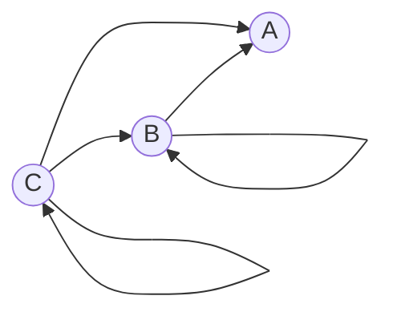

# Задание №7, Вариант 5, команда Itera

## Маршруты в ориентированном графе и взаимные рекуррентные соотношения

### Вариант 5:

Дан ориентированный граф:

Маршрут длины $n$ — это последовательность из $n$ дуг графа; прохождение
петли также считается одним шагом. Найдите количество различных маршрутов
длины $n$, которые начинаются в вершине $C$ и заканчиваются в вершине $A$.

### 1. Составление системы рекуррентных соотношений и сведение её к одному однородному

**Обозначения и начальные условия**

Введём обозначения:

$a_{n}$ - количество маршрутов длины ${n}$, заканчивающихся в вершине A (это то, что нам нужно найти)\
$b_{n}$ - количество маршрутов длины ${n}$, заканчивающихся в вершине B\
$c_{n}$ - количество маршрутов длины ${n}$, заканчивающихся в вершине C.

Число маршрутов длины 1 смотрим по графу:

$a_{1}$ = 1:  За 1 шаг попасть в A можно только из C\
$b_{1}$ = 1:  За 1 шаг попасть в B можно только из C\
$c_{1}$ = 1:  За 1 шаг попасть в C можно только одним способом - пройти по петле из C в C

**Система уравнений**

Выпишем систему рекуррентных соотношений, описывающих количество путей длины ${n}$, ведущих в каждую из вершин ($a_{n}, b_{n}, c_{n}$) и получим систему:

$$
\begin{cases}
a_{n} = b_{n-1} + c_{n-1}\\
b_{n} = b_{n-1} + c_{n-1}\\
c_{n} = c_{n-1}
\end{cases}
$$

**Сведение к одному соотношению**

Заметим: правые части уравнений (1) и (2) абсолютно идентичны ($b_{n-1} + c_{n-1}$).

Кроме того, начальные условия для этих вершин при ${n}$ = 1 совпадают: $a_{1} = 1$ и $b_{1} = 1$

Следовательно, по методу математической индукции последовательности $a_{n}$ и $b_{n}$ полностью совпадают для всех ${n} \ge 1$:

$$
a_{n} = b_{n}
$$

Так как $a_{n} = b_{n}$, мы можем искать формулу для любой из этих величин. Удобнее искать для $b_{n}$, потому что в его уравнении $b_{n} = b_{n-1} + c_{n-1}$ можно сразу подставить известную константу $c_{n-1} = 1$. Получим $b_{n} = b_{n-1} + 1$. Уравнение для $a_{n}$ содержит $b_{n-1}$, и чтобы его решить, нам всё равно пришлось бы сначала находить $b_{n}$.

Из уравнения (3) $c_{n} = c_{n-1}$ следует, что количество путей в 
${C}$ не меняется с каждым шагом. Раз 
$c_{1}$ = 1, то и $c_{n-1}$ = 1 для любого ${n}$.

Подставляем это в уравнение для $b_{n}$:

$$
b_{n} = b_{n-1} + 1 \quad \text{(неоднородное соотношение).}
$$

**Избавляемся от свободного члена**

Запишем то же уравнение шагом ниже (понизим индекс на 1):

$$
b_{n-1} = b_{n-2} + 1
$$

Вычтем второе из первого:

$$
b_{n} - b_{n-1} = (b_{n-1} + 1) - (b_{n-2} + 1)
$$

$$
b_{n} - b_{n-1} = b_{n-1} - b_{n-2}
$$

$$
b_{n} = 2b_{n-1} - b_{n-2} \quad \text{(получили однородное).}
$$

### 2. Составление и решение характеристического уравнения

**Характеристическое уравнение**

Сделаем замену $b_{n} \to \lambda^n$, тогда $b_{n-1} \to \lambda^{n-1}$, $b_{n-2} \to \lambda^{n-2}$.

Получим:

$$
b_{n} =  2b_{n-1} - b_{n-2}
\Leftrightarrow
\lambda^n = 2\lambda^{n-1} - \lambda^{n-2}
$$

Перенесём влево:

$$
\lambda^n -2 \lambda^{n-1} + \lambda^{n-2} = 0
$$

Разделим на $\lambda^{n-2}$ ($\lambda \neq 0$: по теореме Виета свободный член уравнения (равный $1$) есть произведение корней. Так как свободный член не равен нулю, ни один из корней не может быть нулевым.):

$$
\lambda^2 -2 \lambda + 1 = 0
$$

Свернём по формуле сокращенного умножения:

$$
(\lambda - 1)^2 = 0
$$

$$
\lambda - 1 = 0
$$

$$
\lambda_{1} = \lambda_{2} = 1
$$

Итого корень: $1$

**Общее решение**

Корни характеристического уравнения совпали: $\lambda = 1$. При одинаковых корнях общее решение рекуррентного соотношения имеет вид:

$$
b_n = A_1 \cdot n \cdot \lambda^n + A_2 \lambda^n
$$

где $A_1$ и $A_2$ - неопределённые коэффициенты.

Подставляем найденный корень:

$$
b_n = A_1 \cdot n \cdot 1^n + A_2 \cdot 1^n = A_1 n + A_2
$$

### 3. Нахождение формулы для числа маршрутов

**Нахождение неопределённых коэффициентов**
Общее решение содержит два неопределённых коэффициента $A_1$ и $A_2$. Найдём их из начальных условий $b_1 = 1$, $b_2 = a_1 + b_1 = 1 + 1 = 2$.

При $n = 1$:

$$
b_1 = A_1 \cdot 1 \cdot 1 + A_2 \cdot 1 = A_1 + A_2
$$

Из графа: $b_1 = 1$.

При $n = 2$:

$$
b_2 = A_1 \cdot 2 \cdot 1^2 + A_2 \cdot 1^2 = 2A_1 + A_2
$$

Из графа: $b_2 = 2$.

Составим систему:

$$
\begin{cases}
A_1 + A_2 = 1\\
2A_1 + A_2 = 2
\end{cases}
$$

Вычитаем из второго первое, $A_2$ уходит:

$$
A_1 = 1
$$

Подставляем $A_1 = 1$ в первое уравнение:

$$
1 + A_2 = 1
$$

$$
\Rightarrow A_2 = 0
$$

**Итоговая формула**

$$
b_n = 1 \cdot n + 0 = n
$$

Так как мы доказали, что $a_{n} = b_{n}$, то 

$$
a_{n} = {n}
$$

**Ответ: $n$.**

### Проверка полученной формулы (на ${n} = 3$ и ${n} = 4$)

**Подсчет по выведенной формуле**

Используем полученное соотношение $a_{n} = {n}$:

$$
a_{3} = 3
$$

$$
a_{4} = 4
$$

**Проверка прямым перебором по графу**

Выпишем все возможные маршруты из ${C}$ в ${A}$ соответствующей длины:

Для ${n} = 3$:

1. $C \to C \to C \to A$
2. $C \to C \to B \to A$
3. $C \to B \to B \to A$

Всего: 3 маршрута.

Для ${n} = 4$:

Для $n = 4$:
1. $C \to C \to C \to C \to A$
2. $C \to C \to C \to B \to A$
3. $C \to C \to B \to B \to A$
4. $C \to B \to B \to B \to A$

Всего: 4 маршрута.

Результаты прямого подсчета совпадают со значениями, полученными по формуле $a_{n} = {n}$, это подтверждает правильность решения.
