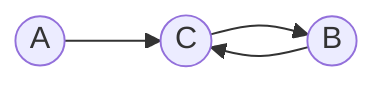
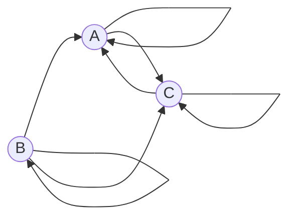
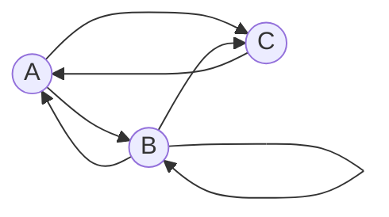
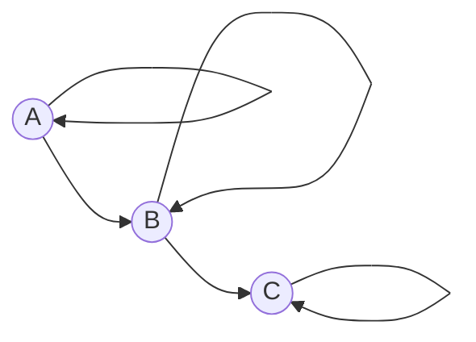
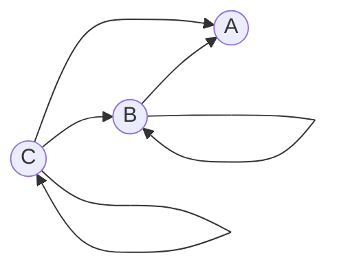
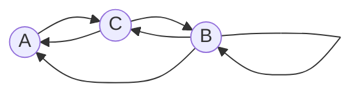
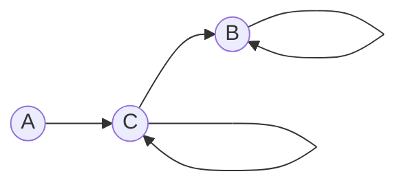
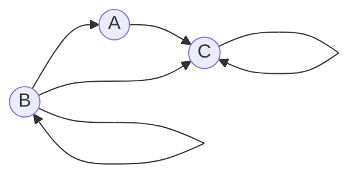
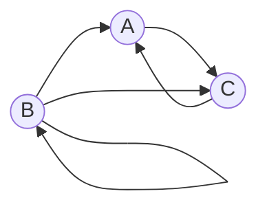
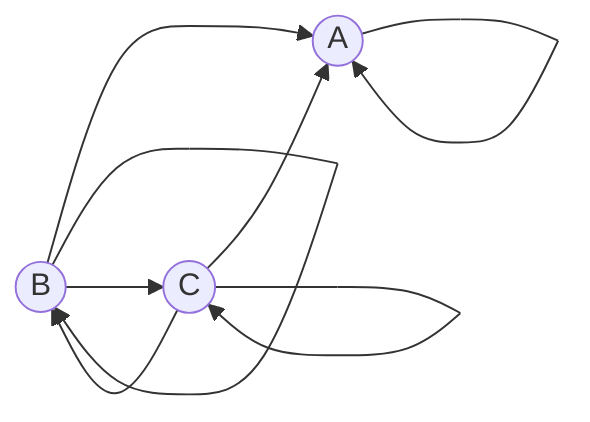

# Задание №7

## Маршруты в ориентированном графе и взаимные рекуррентные соотношения

В каждом варианте дан ориентированный граф с вершинами $A$, $B$ и $C$.

Маршрут длины $n$ — это последовательность из $n$ дуг, в которой конец
каждой дуги совпадает с началом следующей. Требуется найти явную формулу для
числа маршрутов между указанными в варианте начальной и конечной вершинами.

## Порядок решения

Для своего варианта необходимо:

1. Составить систему из рекуррентных соотношений и свести её к одному однородному линейному
   рекуррентному соотношению.
2. Составить и решить характеристическое уравнение.
3. Найти формулу для числа указанных маршрутов.

**Решение должно содержать номер варианта и подробное пошаговое обоснование.**

Решение необходимо изложить в терминах, обозначениях и приёмах, введённых
на лекциях и семинарах. Подмена этого метода аппаратом, который в курсе
не изучался, не принимается, в том числе при верном ответе.

Генеративные модели (ИИ) нельзя использовать ни для решения задачи, ни для
оформления решения. **Использование ИИ, а также плагиат являются нарушением
академических норм и ведут к обнулению оценки.**

Решение нужно оформить в отдельной ветке в файле `ИмяКоманды.md`, расположенном
в каталоге `Задание 7` данного репозитория.

## Оформление и отправка решения

1. Обновить локальную ветку `main` (`git pull`).
2. От ветки `main` создать ветку `ИмяКоманды-task-7`, заменив `ИмяКоманды`
   названием команды.
3. Добавить в каталог `Задание 7` файл `ИмяКоманды.md` с решением.
4. Зафиксировать изменения (`git commit`) и отправить ветку в репозиторий
   (`git push`).
5. Создать pull request: **base** — `main`, **compare** —
   `ИмяКоманды-task-7`.

Полезные материалы:

- [руководство по оформлению Markdown](https://gist.github.com/Jekins/2bf2d0638163f1294637);
- [формулы LaTeX в Markdown](https://grammarware.net/text/syutkin/MathInLaTeX.pdf);
- [диаграммы Mermaid](https://habr.com/ru/articles/652867/).

## Варианты выполнения задания

### Вариант 1:

Дан ориентированный граф:

Маршрут длины $n$ — это последовательность из $n$ дуг графа. Найдите
количество различных маршрутов длины $n$, которые начинаются в вершине $A$
и заканчиваются в вершине $B$.

### Вариант 2:

Дан ориентированный граф:

Маршрут длины $n$ — это последовательность из $n$ дуг графа; прохождение
петли также считается одним шагом. Найдите количество различных маршрутов
длины $n$, которые начинаются в вершине $B$ и заканчиваются в вершине $A$.

### Вариант 3:

Дан ориентированный граф:

Маршрут длины $n$ — это последовательность из $n$ дуг графа; прохождение
петли также считается одним шагом. Найдите количество различных маршрутов
длины $n$, которые начинаются и заканчиваются в вершине $C$.

### Вариант 4:

Дан ориентированный граф:

Маршрут длины $n$ — это последовательность из $n$ дуг графа; прохождение
петли также считается одним шагом. Найдите количество различных маршрутов
длины $n$, которые начинаются в вершине $A$ и заканчиваются в вершине $C$.

### Вариант 5:

Дан ориентированный граф:

Маршрут длины $n$ — это последовательность из $n$ дуг графа; прохождение
петли также считается одним шагом. Найдите количество различных маршрутов
длины $n$, которые начинаются в вершине $C$ и заканчиваются в вершине $A$.

### Вариант 6:

Дан ориентированный граф:

Маршрут длины $n$ — это последовательность из $n$ дуг графа; прохождение
петли также считается одним шагом. Найдите количество различных маршрутов
длины $n$, которые начинаются в вершине $B$ и заканчиваются в вершине $C$.

### Вариант 7:

Дан ориентированный граф:

Маршрут длины $n$ — это последовательность из $n$ дуг графа; прохождение
петли также считается одним шагом. Найдите количество различных маршрутов
длины $n$, которые начинаются в вершине $A$ и заканчиваются в вершине $B$.

### Вариант 8:

Дан ориентированный граф:

Маршрут длины $n$ — это последовательность из $n$ дуг графа; прохождение
петли также считается одним шагом. Найдите количество различных маршрутов
длины $n$, которые начинаются в вершине $B$ и заканчиваются в вершине $C$.

### Вариант 9:

Дан ориентированный граф:

Маршрут длины $n$ — это последовательность из $n$ дуг графа; прохождение
петли также считается одним шагом. Найдите количество различных маршрутов
длины $n$, которые начинаются в вершине $B$ и заканчиваются в вершине $A$.

### Вариант 10:

Дан ориентированный граф:

Маршрут длины $n$ — это последовательность из $n$ дуг графа; прохождение
петли также считается одним шагом. Найдите количество различных маршрутов
длины $n$, которые начинаются в вершине $B$ и заканчиваются в вершине $A$.