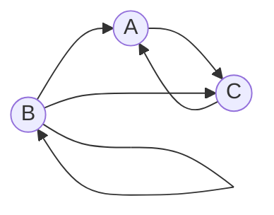

# Задание №7

## Вариант 9

### Условие задачи

Дан ориентированный граф:

Маршрут длины $n$ — это последовательность из $n$ дуг графа, в которой конец каждой дуги совпадает с началом следующей. Прохождение петли также считается одним шагом.

Требуется найти явную формулу для количества различных маршрутов длины $n$, которые начинаются в вершине $B$ и заканчиваются в вершине $A$.

---

### 1. Составление системы рекуррентных соотношений

- $a_n$ — количество маршрутов длины $n$, начинающихся в вершине B и заканчивающихся в вершине A.
- $b_n$ — количество маршрутов длины $n$, начинающихся в вершине B и заканчивающихся в вершине B.
- $c_n$ — количество маршрутов длины $n$, начинающихся в вершине B и заканчивающихся в вершине C.

Необходимо найти явную формулу для $a_n$.

По каким дугам маршрут может попасть в каждую из вершин на последнем шаге.

Для вершины A:

В вершину $A$ входят две дуги:

$B \to A$ 
$C \to A$

Следовательно, количество маршрутов длины n, заканчивающихся в A, равно сумме количеств маршрутов длины n-1, заканчивающихся в B и C:

$$
a_n=b_{n-1}+c_{n-1}
$$

Для вершины B:

В вершину B входит только петля:

 $B \to B$

Поэтому:

$$
b_n=b_{n-1}
$$

Для вершины C:

В вершину C входят две дуги:

- $A \to C$
- $B \to C$

Следовательно:

$$
c_n=a_{n-1}+b_{n-1}
$$

Таким образом, получаем систему взаимных рекуррентных соотношений:

$$
\begin{cases}
a_n=b_{n-1}+c_{n-1}\\
b_n=b_{n-1}\\
c_n=a_{n-1}+b_{n-1}
\end{cases}
$$

### 2. Определение начальных условий

Количество маршрутов длины = 1, начинающихся в вершине B.

Из вершины $B$ выходят три дуги:

1. $B \to A$
2. $B \to B$
3. $B \to C$

Следовательно:

$$
a_1=1,\quad b_1=1,\quad c_1=1
$$

Количество маршрутов длины = 2.

Используем полученную систему:

$$
a_2=b_1+c_1=1+1=2
$$

$$
b_2=b_1=1
$$

$$
c_2=a_1+b_1=1+1=2
$$

Проверка непосредственным перечислением.

Маршруты длины = 2 из B в A:

1. $B \to B \to A$
2. $B \to C \to A$

Маршрут длины $2$ из $B$ в $B$:

1. $B \to B \to B$

Маршруты длины $2$ из $B$ в $C$:

1. $B \to A \to C$
2. $B \to B \to C$

Таким образом:

$$
a_2=2,\quad b_2=1,\quad c_2=2
$$

### 3. Сведение системы к одному рекуррентному соотношению

Второе уравнение системы:

$$
b_n=b_{n-1}
$$

Поскольку $b_1=1$, получаем:

$$
b_n=1
$$

Значит для любой длины n существует ровно один маршрут из B в B, состоящий из последовательного прохождения петли.

Первое и третье уравнения:

$$
a_n=b_{n-1}+c_{n-1}
$$

$$
c_n=a_{n-1}+b_{n-1}
$$

Из начальных условий известно

$$
a_1=c_1=1
$$

Покажем, что $a_n=c_n$ для всех $n\geq1$.

Пусть для некоторого n-1 выполняется

$$
a_{n-1}=c_{n-1}
$$

Тогда правые части уравнений

$$
a_n=b_{n-1}+c_{n-1}
$$

и

$$
c_n=a_{n-1}+b_{n-1}
$$

совпадают.

Следовательно, $a_n=c_n$.

Поскольку равенство выполняется при $n=1$, по индукции:

$$
a_n=c_n
$$

Подставить $b_{n-1}=1$ и $c_{n-1}=a_{n-1}$ в первое уравнение системы:

$$
a_n=b_{n-1}+c_{n-1}
$$

Получится:

$$
a_n=1+a_{n-1}
$$

Таким образом, система сведена к одному рекуррентному соотношению:

$$
a_n=a_{n-1}+1
$$

Это неоднородное линейное рекуррентное соотношение первого порядка.

Чтобы получить однородное соотношение, необходимо записать его для $n$ и для $n-1$:

$$
a_n=a_{n-1}+1
$$

$$
a_{n-1}=a_{n-2}+1
$$

Вычесть второе равенство из первого, перенести все слагаемые в левую часть

$$
a_n-2a_{n-1}+a_{n-2}=0
$$

Однородное линейное рекуррентное соотношение второго порядка с постоянными коэффициентами, справедливое при $n\geq3$.

### 4. Составление и решение характеристического уравнения

Для полученного рекуррентного соотношения

$$
a_n-2a_{n-1}+a_{n-2}=0
$$

нужно составить характеристическое уравнение.

Решение в виде:

$$
a_n=\lambda^n
$$

Подставить его в рекуррентное соотношение:

$$
\lambda^n-2\lambda^{n-1}+\lambda^{n-2}=0
$$

Вынесение $\lambda^{n-2}$ за скобки:

$$
\lambda^{n-2}(\lambda^2-2\lambda+1)=0
$$

Для ненулевого $\lambda$:

$$
\lambda^2-2\lambda+1=0
$$

Разложение левой части на множители:

$$
(\lambda-1)^2=0
$$

Характеристический корень:

$$
\lambda_1=\lambda_2=1
$$

Корень $\lambda=1$ имеет кратность $2$.

Поскольку характеристическое уравнение имеет один двукратный корень, общее решение рекуррентного соотношения имеет вид

$$
a_n=(K_1+K_2n)\lambda^n
$$

Множитель $n$ появляется из-за кратности корня: для двукратного корня $\lambda$ используются решения $\lambda^n$ и $n\lambda^n$.

Подставление $\lambda=1$:

$$
a_n=(K_1+K_2n)\cdot1^n
$$

Поскольку $1^n=1$, получается:

$$
a_n=K_1+K_2n
$$

### 5. Определение произвольных констант

Для нахождения констант $K_1$ и $K_2$ используются условия, полученные ранее:

$$
a_1=1,\qquad a_2=2
$$

Подставление $n=1$ в общее решение:

$$
1=K_1+K_2
$$

Подставление $n=2$:

$$
2=K_1+2K_2
$$

Система:

$$
\begin{cases}
K_1+K_2=1\\
K_1+2K_2=2
\end{cases}
$$

Вычесть первое уравнение из второго:

$$
K_2=2-1
$$

$$
K_2=1
$$

Подставить найденное значение в первое уравнение:

$$
K_1+1=1
$$

$$
K_1=0
$$

Таким образом, общее решение принимает вид:

$$
a_n=0+1\cdot n
$$

Получается явная формула:

$$
a_n=n
$$

### 6. Проверка полученной формулы

Проверить результат для маршрутов длины $3$ и $4$.

#### Проверка для n = 3

По полученной формуле:

$$
a_3=3
$$

Все маршруты длины $3$, начинающиеся в $B$ и заканчивающиеся в $A$:

1. $B \to B \to B \to A$
2. $B \to B \to C \to A$
3. $B \to A \to C \to A$

Всего существует $3$ маршрута.

Следовательно:

$$
a_3=3
$$

Количество маршрутов совпадает с результатом, полученным по формуле.

#### Проверка для n = 4

По полученной формуле:

$$
a_4=4
$$

Все маршруты длины $4$, начинающиеся в $B$ и заканчивающиеся в $A$:

1. $B \to B \to B \to B \to A$
2. $B \to B \to B \to C \to A$
3. $B \to B \to A \to C \to A$
4. $B \to C \to A \to C \to A$

Всего существует $4$ маршрута.

Следовательно:

$$
a_4=4
$$

Результат также совпадает с полученной формулой.

Таким образом, проверка для $n=3$ и $n=4$ подтверждает верность найденного решения.

### 7. Ответ

Для заданного ориентированного графа количество различных маршрутов длины $n$, начинающихся в вершине $B$ и заканчивающихся в вершине $A$, определяется формулой:

$$
a_n=n,\qquad n\geq1
$$

При $n=0$ маршрутов из $B$ в $A$ также нет, поэтому формула остаётся верной и для $n=0$.

Ответ:

$$
a_n=n,\qquad n\geq0
$$