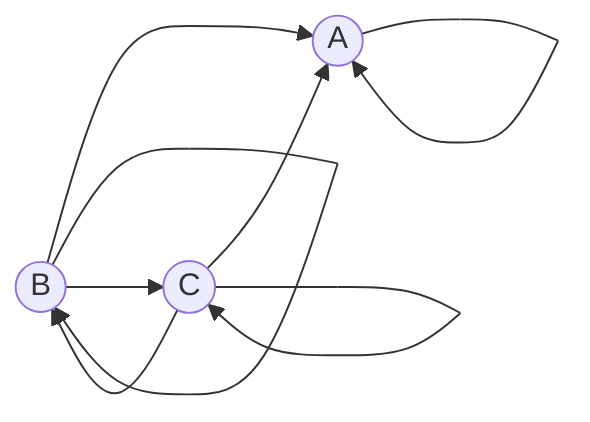

# Условие и обозначения

## Задание. Вариант 10:
Дан ориентированный граф с тремя вершинами:

Маршрут длины $n$ — это последовательность из $n$ дуг графа; прохождение
петли также считается одним шагом. Найдите количество различных маршрутов
длины $n$, которые начинаются в вершине $B$ и заканчиваются в вершине $A$.

## Что имеем

Нужно найти формулу для числа маршрутов длины $n$ из **B** в **A**. Маршрут длины $n$ — это ровно $n$ шагов по дугам, и петля тоже считается шагом. Например, B→B→A — это маршрут длины 2.

| Откуда | Куда ведут дуги |
|---|---|
| A | A (петля) |
| B | A, B (петля), C |
| C | A, B, C (петля) |

Число маршрутов растёт экспоненциально. Поэтому задачу сводим к рекуррентному соотношению.

# Решение
**Решить можно двумя способами:**

Способ 1. Фиксируем начало, меняем конец, смотрим на последний шаг.
Вопрос: откуда я мог прийти в эту вершину? Нужны входящие дуги.

Способ 2. Фиксируем конец, меняем начало, смотрим на первый шаг.
Вопрос: куда я могу пойти из этой вершины? Нужны исходящие дуги.

Выберу первый способ.

## Шаг 1. Система рекуррентных соотношений

Введём три последовательности: $a_n$, $b_n$, $c_n$ — число маршрутов длины $n$, которые начинаются в B и заканчиваются в A, B и C соответственно.

Главная идея: смотрим, **откуда пришёл последний шаг**. В вершину A ведут дуги из A, B и C. В вершину B ведут дуги из B и C. В вершину C ведут дуги из B и C. Отсюда:

$$
\begin{cases}
a_{n+1} = a_n + b_n + c_n \\
b_{n+1} = b_n + c_n \\
c_{n+1} = b_n + c_n
\end{cases}
$$

Начальные условия при $n = 0$ (стоим в B, шагов не делали): $a_0 = 0,\; b_0 = 1,\; c_0 = 0$.

**Сведение к одному соотношению.** Обозначим $s_n = b_n + c_n$. Получаем два факта, и оба верны **для любого** $n$:

$$
(1)\quad a_{n+1} - a_n = s_n
$$

$$
(2)\quad s_{n+1} = 2s_n
$$

Равенство (1) верно при любом $n$, поэтому можно подставить вместо $n$ число $n+1$ (**Рекуррентное равенство — это бесконечно много равенств**):

$$
a_{(n+1)+1} - a_{n+1} = s_{n+1}, \quad\text{то есть}\quad a_{n+2} - a_{n+1} = s_{n+1}
$$

Равенство (2) получается сложением уравнений для $b$ и $c$:

$$
s_{n+1} = b_{n+1} + c_{n+1} = (b_n + c_n) + (b_n + c_n) = 2s_n
$$

Приравниваем (1) и (2) и получаем:

$$
a_{n+2} - a_{n+1} = s_{n+1} = 2s_n
$$

Тогда

$$
a_{n+2} - a_{n+1} = s_{n+1} = 2s_n = 2(a_{n+1} - a_n),
$$

Из этого равенства достаем первое и последнее, получается:

$$
\boxed{a_{n+2} = 3a_{n+1} - 2a_n}
$$

Это однородное линейное рекуррентное соотношение второго порядка.

### Шаг 2. Характеристическое уравнение

Подставляем $a_n = r^n$ и получаем $r^2 - 3r + 2 = 0$, откуда $r_1 = 1$, $r_2 = 2$.

Корни различные, поэтому общее решение имеет вид $a_n = \alpha \cdot 1^n + \beta \cdot 2^n$. - В задании 4 подробно расписывал виды общих решений

Здесь $\alpha$ и $\beta$ пока неизвестны. Этот вид подходит под рекуррентное соотношение при **любых** $\alpha, \beta$, но под нашу задачу — только при конкретных.

### Шаг 3. Константы из начальных условий

Нужны $a_0$ и $a_1$, поскольку строка $a_n$ отвечает на вопрос сколько способов попасть в A из B

**Подставляем начальные условия.**
- При $n = 0$: $\alpha + \beta \cdot 2^0 = \alpha + \beta$, а должно быть $a_0 = 0$.
- При $n = 1$: $\alpha + \beta \cdot 2^1 = \alpha + 2\beta$, а должно быть $a_1 = 1$.

Отсюда система:

$$
\begin{cases} \alpha + \beta = 0 \\ \alpha + 2\beta = 1 \end{cases}
$$

**Решаем.** Вычитаем первое уравнение из второго: $\beta = 1$. Тогда $\alpha = -1$.

**Подставляем обратно** в общий вид:

$$
a_n = -1 + 1 \cdot 2^n = 2^n - 1
$$

**Ответ:**

$$
\boxed{a_n = 2^n - 1}
$$

**Проверка:**

| $n$ | Маршруты | Количество | $2^n-1$ |
|---|---|---|---|
| 1 | B→A | 1 | 1 |
| 2 | B→A→A, B→B→A, B→C→A | 3 | 3 |
| 3 | … | 7 | 7 |
