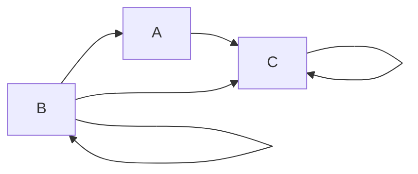

Задание №7. Вариант 8

Маршруты в ориентированном графе и взаимные рекуррентные соотношения

Цель работы: найти явную формулу для числа маршрутов длины $n$, начинающихся в вершине $B$ и заканчивающихся в вершине $C$.

Граф варианта 8: дуги $B \to A$, $A \to C$, $B \to C$, а также петли $B \to B$ и $C \to C$.

### 1. Составление системы рекуррентных соотношений

Все маршруты начинаются в вершине $B$. Введём обозначения: $A_n$, $B_n$, $C_n$ - количество маршрутов длины $n$, которые начинаются в $B$ и заканчиваются в вершинах $A$, $B$, $C$ соответственно.

Длина маршрута - это количество пройденных дуг; прохождение петли считается одним шагом.

Выведем соотношения по комбинаторному принципу сложения: маршрут длины $n$, заканчивающийся в данной вершине, получается продолжением маршрута длины $n-1$ по одной из дуг, входящих в эту вершину.

- В вершину $A$ входит одна дуга - из $B$. Значит, $A_n = B_{n-1}$.
- В вершину $B$ входит только петля $B \to B$. Значит, $B_n = B_{n-1}$.
- В вершину $C$ входят три дуги: из $A$, из $B$ и петля из $C$. Значит, $C_n = A_{n-1} + B_{n-1} + C_{n-1}$.

Других маршрутов нет, так как других входящих дуг в эти вершины граф не содержит.

Получаем систему взаимных рекуррентных соотношений ($n \ge 2$):

$$
\begin{cases}
A_n = B_{n-1} \\
B_n = B_{n-1} \\
C_n = A_{n-1} + B_{n-1} + C_{n-1}
\end{cases}
$$

Начальные условия (маршруты длины $1$ из $B$): по графу из $B$ выходят дуги в $A$, в $B$ (петля) и в $C$, поэтому

$$
A_1 = 1, \quad B_1 = 1, \quad C_1 = 1.
$$

### 2. Сведение к одному однородному линейному рекуррентному соотношению

Нужно исключить $A_n$ и $B_n$ и получить уравнение только для $C_n$.

Из второго уравнения $B_n = B_{n-1}$ и $B_1 = 1$ следует $B_n = 1$ при всех $n \ge 1$. Из первого уравнения $A_n = B_{n-1} = 1$ при $n \ge 2$, а $A_1 = 1$ по начальному условию, значит $A_n = 1$ при всех $n \ge 1$.

Подставим в третье уравнение. Для $n \ge 2$ величины $A_{n-1}$ и $B_{n-1}$ имеют номер $n-1 \ge 1$, поэтому обе равны $1$:

$$
C_n = C_{n-1} + 2, \quad n \ge 2.
$$

Слагаемое $2 = A_{n-1} + B_{n-1}$ не зависит от $n$, поэтому его можно исключить. Запишем то же равенство для предыдущего номера (оно верно при $n \ge 3$):

$$
C_{n-1} = C_{n-2} + 2.
$$

Вычтем второе равенство из первого:

$$
C_n - C_{n-1} = C_{n-1} - C_{n-2},
$$

$$
C_n = 2C_{n-1} - C_{n-2}, \quad n \ge 3.
$$

Это линейное однородное рекуррентное соотношение с постоянными коэффициентами глубины $2$. Для него нужны два начальных условия: $C_1$ и $C_2$.

### 3. Характеристическое уравнение и общее решение

Заменим $C_n$ на $\lambda^n$, разделим на $\lambda^{n-2}$ ($\lambda \ne 0$) и перенесём всё в левую часть:

$$
\lambda^2 - 2\lambda + 1 = 0.
$$

Левая часть раскладывается:

$$
(\lambda - 1)^2 = 0.
$$

Корни совпадают: $\lambda_1 = \lambda_2 = 1$, то есть один корень $\lambda = 1$ кратности $2$. Для кратного корня общее решение имеет вид

$$
C_n = (\alpha_1 + \alpha_2 n)\lambda^n = \alpha_1 + \alpha_2 n.
$$

### 4. Нахождение констант

Значение $C_1 = 1$ известно из начальных условий. Найдём $C_2$ из системы:

$$
C_2 = A_1 + B_1 + C_1 = 1 + 1 + 1 = 3.
$$

Подставим $n = 1$ и $n = 2$ в общее решение:

$$
\begin{cases}
\alpha_1 + \alpha_2 = 1 \\
\alpha_1 + 2\alpha_2 = 3
\end{cases}
$$

Вычитая первое уравнение из второго, получаем $\alpha_2 = 2$, затем $\alpha_1 = 1 - 2 = -1$.

Итак,

$$
C_n = 2n - 1, \quad n \ge 1.
$$

### 5. Проверка

Проверим формулу при $n = 3$: $C_3 = 2 \cdot 3 - 1 = 5$.

Перечислим по графу все маршруты длины $3$ из $B$ в $C$:

1. $B \to B \to B \to C$
2. $B \to B \to A \to C$
3. $B \to B \to C \to C$
4. $B \to A \to C \to C$
5. $B \to C \to C \to C$

Их ровно $5$, формула верна.

Ответ: количество различных маршрутов длины $n$ из вершины $B$ в вершину $C$ равно $2n - 1$ ($n \ge 1$).
