# Задание №8

## Оптимальное расписание: конвейерная задача и ленточная стратегия

В каждом варианте даны условия **двух** задач теории расписаний.

Для **каждой** задачи варианта необходимо построить расписание, выполняемое в кратчайшие сроки:

1. Выбрать алгоритм решения и обосновать выбор, сопоставив условие с постановкой соответствующей модельной задачи.
2. Применить выбранный алгоритм; в решении отобразить ход выполнения с **подробными комментариями**.
3. Указать длительность полученного расписания.
4. Вывести расписание в виде диаграммы Ганта.
5. Придумать интерпретацию заданных условий из какой-либо предметной области, соответствующую постановке задачи и её смыслу. Дополнительные баллы начисляются за лучшие интерпретации, если они оригинальны: похожая интерпретация другой команды, предложенная позже, на дополнительные баллы не претендует.

Диаграмму Ганта можно оформить блоком Mermaid `gantt` либо аккуратной таблицей по образцу лекции. В Mermaid удобно трактовать условные единицы как часы (`dateFormat HH:mm`).

**Решение должно содержать номер варианта и подробное пошаговое обоснование.**

Решение необходимо изложить в терминах, обозначениях и приёмах, введённых на лекциях и семинарах. Подмена этого метода аппаратом, который в курсе не изучался, не принимается, в том числе при верном ответе.

### Вариант 13:

# **Задача 1.** Имеется 9 независимых заданий, каждое из которых состоит из двух последовательных этапов, и 2 исполнителя: первый выполняет только первый этап каждого задания, второй — только второй. Прерывания запрещены.

Длительности этапов:

| | $A$ | $B$ | $C$ | $D$ | $E$ | $F$ | $G$ | $H$ | $I$ |
| --- | :---: | :---: | :---: | :---: | :---: | :---: | :---: | :---: | :---: |
| Первый этап | 5 | 14 | 9 | 3 | 18 | 8 | 14 | 1 | 6 |
| Второй этап | 7 | 17 | 4 | 5 | 18 | 8 | 10 | 6 | 2 |

Постройте расписание выполнения всех заданий в кратчайшие сроки.

### Решение:
  
Задания **независимы** друг относительно друга, но каждое задание  
состоит из **2х строго последовательных этапов**,  
заданной последовательности и имеется **2 исполнителя**,  
каждый из которых выполняет **только определённый** этап:  
либо только первый, либо только второй.  

Прерывания в процессе исполнения любого этапа, когда любой  
из исполнителей приступил к выполнию своего этапа, запрещены.  

Необходимо построить расписание выполнения всех заданий  
в кратчайшие сроки.
  
Это классическая конвейерная задача.  

Для решения данного класса задач построения оптимального расписания  
оптимален алгоритм Джонсона, который мы используем для решения.  

Для этого:  

## 1. Разделим задания на 2 группы:  

#### **$F_1$**:  Задания, второй этап которых выполняется дольше чем первый(длительность второго этапа больше или равна длительности первого).  

**$F_1$** = [ A, B, D, E, F, H ]  

| | $A$ | $B$ | $D$ | $E$ | $F$ | $H$ |
| --- | :---: | :---: | :---: | :---: | :---: | :---: |
| **$Этап_1$** | 5 | 14 | 3 | 18 | 8 | 1 |
| **$Этап_2$** | 7 | 17 | 5 | 18 | 8 | 6 |

**$F_2$**:  Задания, второй этап которых выполняется быстрее первого  
(по сути все остальные, не попавшие в группу **$F_1$**).  

**$F_2$** = [ C, G, I ]

| | $C$ | $G$ | $I$ |
| --- | :---: | :---: | :---: |
| **$Этап_1$** | 9 | 14 | 6 |
| **$Этап_2$** | 4 | 10 | 2 |

## 2. Отсортируем полученные группы заданий **$F_1$** и **$F_2$**:

Первую группу **$F_1$** отсортируем по возрастанию длительности первого этапа, а вторую **$F_2$** по убыванию длительности второго этапа.  

#### **$F_1$** = [ H, D, A, F, B, E ]  
| | $H$ | $D$ | $A$ | $F$ | $B$ | $E$ |
| --- | :---: | :---: | :---: | :---: | :---: | :---: |
| **$Этап_1$** | 1 | 3 | 5 | 8 | 14 | 18 |
| **$Этап_2$** | 6 | 5 | 7 | 8 | 17 | 18 |

#### **$F_2$** = [ G, C, I ]

| | $G$ | $C$ | $I$ |
| --- | :---: | :---: | :---: |
| **$Этап_1$** | 14 | 9 | 6 |
| **$Этап_2$** | 10 | 4 | 2 |

## 3. Получим оптимальное расписание по алгоритму Джонсона:  

Оптимальным для данной задачи будет подавать задания на выполнение  
первому исполнителю по порядку полученному нами сейчас:  
сначала из группы **$F_1$**, а после её исчерпания из группы **$F_2$**  

Второй исполнитель приступает к своему этаму задания,
когда выполнен первый этап задания и задание попадает к нему.  

Или, если в этот момент занят, сразу как освободится приступает  
к заданиям которым может, в том порядке как они  
поступают к нему после завершения выполнения  
первого этапа первым исполнителем.
 
#### **$F_1$** = [ H, D, A, F, B, E, G, C, I ]  
| | $H$ | $D$ | $A$ | $F$ | $B$ | $E$ | $C$ | $G$ | $I$ |
| --- | :---: | :---: | :---: | :---: | :---: | :---: |:---: |:---: |:---: |
| **$Этап_1$** | 1 | 3 | 5 | 8 | 14 | 18 | 14 | 9 | 6 |
| **$Этап_2$** | 6 | 5 | 7 | 8 | 17 | 18 | 10 | 4 | 2 |

## 4. Продолжительности работ при таком расписании будет наименьшей, что обеспечено тем, что Алгоритм Джонсона минимизирует одновременно простои второго исполнителя в ожидании завершения первым исполнителем своего этапа задания и, одновременно, гарантированно минимален простой первого исполнителя после завершения своего этапа для всех заданий, пока второй исполнитель будет заканчивать второй этап заданий, находящихся в этот момент в его очереди.

## 5. Найдём суммарную продолжительность и построим диаграмму Ганта.

# Ответ:

```mermaid
gantt
    title Диаграмма Ганта
    dateFormat HH
    axisFormat %H:%M
    section Первый этап:
    H :H_1, 00, 1h 
    D :D_1, after H_1, 3h
    A :A_1, after D_1, 5h
    F :F_1, after A_1, 8h  
    B :B_1, after F_1, 14h  
    E :E_1, after B_1, 18h  
    C :C_1, after E_1, 9h  
    G :G_1, after C_1, 5h
    I :I_1, after G_1, 6h
    Простой: crit, after I_1, 14h
    section Второй этап:
    Простой: crit, 00, 1h
    H :H_2, after H_1, 6h 
    D :D_2, after H_2, 5h
    A :A_2, after D_2, 7h
    F :F_2, after A_2, 8h
    Простой: crit, after F_2, 4h  
    B :B_2, after B_1, 17h
    Простой: crit, after B_2, 1h  
    E :E_2, after E_1, 18h  
    C :C_2, after E_2, 10h  
    G :G_2, after C_2, 4h
    I :I_2, after G_2, 2h
```

# Суммарная продолжительность:  
$$ 1 + 3 + 5 + 8 + 14 + 18 + 18 + 10 + 4 + 2 = 83_ч $$

## Простой первого исполнителя в конце расписания:  
$$ 83 - 1 - 3 - 5 - 8 - 14 - 18 - 9 - 5 - 6 = 14_ч $$

## Простои второго исполнителя в процессе работы:  
1. $1$ час в начале расписания пока не выполнен первый этап задания **H**
2. $4$ часа после выполнения своего этапа задания **F**, пока не будет закончен первый этап работы **B**. 
3. $1$ час после выполнения своего этапа задания **B**, пока не будет закончен первый этап работы **E**.
### Суммарный простой второго исполнителя: $6_ч$

# **Задача 2.** Имеется 9 независимых заданий и 5 универсальных исполнителей. Прерывания допускаются.

Длительности заданий:

| | $A$ | $B$ | $C$ | $D$ | $E$ | $F$ | $G$ | $H$ | $I$ |
| --- | :---: | :---: | :---: | :---: | :---: | :---: | :---: | :---: | :---: |
| Длительность | 15 | 9 | 7 | 6 | 5 | 4 | 3 | 3 | 2 |

Постройте расписание выполнения всех заданий в кратчайшие сроки. 

### Решение:

**9 Заданий независимы** друг относительно друга.  
**5 Исполнителей уневерсальны**, т.е. **любой** может  
выполнять **любое задание**, причём любое задание  
**можно прервать**, после чего оно может быть  
**продолжено в любое время, любым** не занятым исполнителем.  

Необходимо построить расписание выполнения всех заданий  
в кратчайшие сроки.

Для решения данного класса задач построения оптимального расписания  
оптимальна классическая ленточная стратегия, которую мы используем  
для решения.  

Для этого:  

## 1. Отсортируем задания:

Отсортируем задания по убыванию длительности.

| | $A$ | $B$ | $C$ | $D$ | $E$ | $F$ | $G$ | $H$ | $I$ |
| --- | :---: | :---: | :---: | :---: | :---: | :---: | :---: | :---: | :---: |
| Длительность | 15 | 9 | 7 | 6 | 5 | 4 | 3 | 3 | 2 |

## 2. Вычислим суммарную длительность всех заданий:
$$ Sum = 15 + 9 + 7 + 6 + 5 + 4 + 3 + 3 + 2 = 54$$

## 3. Найдём среднюю продуктивность исполнителя в оптимальном расписании:
$$ Avg = 54/5 = 10.75$$
округлим:
$$ Avg = 11$$

## 4.Определим длительность оптимального раписания:
При данных нам условиях, длительность оптимального расписания будет максимумом между длительностью самого длинного задания и средней продуктивностью исполнителя. 

$$ T = max(15, 11) = 15 $$

Короче 15 часов расписание не может быть, потому что  
хоть задание и можно прерывать, но в один момент времени  
над заданием может работать хоть и любой, но только один исполнитель.

## 5. Найдём суммарную продолжительность и построим диаграмму Ганта.

# Ответ:

```mermaid
gantt
    title Диаграмма Ганта
    dateFormat HH
    axisFormat %H:%M
    section 1:
    A :A, 00, 15h 
    section 2:
    B :B, 00, 9h 
    C :C_1, after B, 6h
    section 3:
    С :C_2, 00, 1h
    D :D, after C_2, 6h  
    E :E, after D, 5h
    F :F_1, after E, 3h  
    section 4:  
    F :F_2, 00, 1h  
    C :C, after F_2, 3h  
    G :G, after C, 3h
    I :I, after G, 2h
    Простой: crit, after I, 15
    section 5:
    Простой: crit, 00, 15h
```

## Простой четвёртого исполнителя в конце расписания:  
$$ Простой_4 = 15 - 1 - 3 - 3 - 2 = 6_ч $$

## Пятый исполнитель в принципе без заданий в течении смены пока мы придерживаемся кслассической ленточной стратегии для составления оптимального расписания.  
$$ Простой_5 = 15 $$

# Можем проверить наше расписание:

$$ T * N_{исп} = 15 * 5 = 75
$$
$$Sum = 54$$

$$ 75 - 54 = 21 = 15 + 6 = {Простой}_4 + {Простой}_5 $$

# Всё верно!
