# Задание №8, Вариант 10, команда Itera

## Оптимальное расписание: конвейерная задача и ленточная стратегия

## Задача 1

### Условие

Имеется 7 независимых заданий и 4 универсальных исполнителя. Прерывания допускаются. Задача - построить расписание выполнения всех заданий в кратчайшие сроки.

Длительности заданий:

| | $A$ | $B$ | $C$ | $D$ | $E$ | $F$ | $G$ |
| --- | :---: | :---: | :---: | :---: | :---: | :---: | :---: |
| Длительность | 8 | 7 | 7 | 6 | 5 | 4 | 3 |

### Алгоритм

Затраченное время будет минимально, если в каждый момент все исполнители будут заняты, пока задачи не закончатся.

Однако затраченное время не может быть меньше времени одной задачи, т.к. её не могут выполнять несколько исполнителей.

Тогда любое расписание займёт времени не меньше чем: $T_{opt} = max( t_1, t_2, \dots\space t_N,  \sum_i^n t_i \space/ \space m)$, где 
$m$ = число исполнителей, $t_i$ - время задачи $i$, $n$ - количество задач.

Воспользуемся ленточной стратегией: составим ленту (очередь) из задач, и поделим на m кусков, для каждого исполнителя - размером $T_{opt}$
- Длина куска, $T_{opt}$, гарантирует минимальное время расписания
- Т.к. $T_{opt}$ не меньше длительности каждой из задач, то каждое разделение очереди не сможет поделить задачу больше, чем на 2 части, и время начала задачи в первом куске всегда будет больше, чем время конца её выполнения в следующем - т.е. два исполнителя никогда не будут делать одну задачу одновременно

Условие модельной задачи для ленточного алгоритма не отличается от поставленной.

### Решение

Составляем ленту:

```mermaid
gantt
    title Очередь
    dateFormat HH:mm
    axisFormat %H:%M
    section Очередь
    A :a1, 00:00, 8h
    B :a2, after a1, 7h
    C :a3, after a2, 7h
    D :a4, after a3, 6h
    E :a5, after a4, 5h
    F :a6, after a5, 4h
    G :a7, after a6, 3h
```

Определим $T_{opt}$.

Максимальная длительность задачи - 8 (A).

Сумма задач - $8+7+7+6+5+4+3 = 40$.

Число исполнителей - 4.

$T_{opt} = max( 8,  40 \space / \space 4) = max( 8, 10 ) = 10$

Поделим очередь на 4 куска по 10. Заметим, что получившийся результат должен быть без простоев, т.к. $T_{opt}$ определилась не длиной максимальной задачи, а их суммой.

```mermaid
gantt
    title Расписание
    dateFormat HH:mm
    axisFormat %H:%M
    section Исполнитель I
    A :a1, 00:00, 8h
    B :a2, after a1, 2h

    section Исполнитель II
    B :b1, 00:00, 5h
    C :b2, after b1, 5h

    section Исполнитель III
    C :c1, 00:00, 2h
    D :c2, after c1, 6h
    E :c3, after c2, 2h

    section Исполнитель IV
    E :d1, 00:00, 3h
    F :d2, after d1, 4h
    G :d3, after d2, 3h
```

Итог получился без простоев и минмимально возможной длительности, задачи B, C, E получились с перерывами.

Проверим:

 [x] ни одна задача не выполнялась параллельно

**Итоговая длительность:** 10.

### Интерпретация

Программисты сделали изменения в проект, но в правилах работы с исходным кодом - необходимость каждому коммиту пройти тесты. Тесты для разных видов изменений длятся разное число часов - кому-то нужно пройти компиляцию проекта только на одной платформе, другому нужно несколько, кому-то пересборка запечёных файлов. Так как все всё доделывали до последней минуты рабочего дня, все отправляют автотесты перед уходом, и надеются что к утру всё будет готово.

Известно, сколько есть компьютеров, которые выделены под сборку и автотесты, одновременно выполнять несколько задач нет смысла - вся мощность компьютера уходит на каждую из задач, а многие тесты потребуют последовательных действий (но которые можно прервать и передать данные другому компьютеру). Передача, на самом деле, будет с небольшими потерями - но т.к. передача с данным алгоритмом может быть всего одна - можно временем, потраченным на неё, пренебречь.

Время каждого теста примерно известно, т.к. их запускают регулярно и можно выдать достаточно точную догадку каждой задаче, и предположим, что никто не откладывал серьёзного рефактора, который заметно изменил бы время теста.

Сделать как можно раньше какую-то конкретную задачу не нужно - все программисты смогут посмотреть результат только утром, когда придут на работу, а сделать все задачи вместе как можно раньше надо бы.

## Задача 2

### Условие

Имеется 10 независимых заданий, каждое из которых состоит из двух последовательных этапов, и 2 исполнителя: первый выполняет только первый этап каждого задания, второй — только второй. Прерывания запрещены.

Длительности этапов:

|             | $A$ | $B$ | $C$ | $D$ | $E$ | $F$ | $G$ | $H$ | $I$ | $J$ |
| --- | :---: | :---: | :---: | :---: | :---: | :---: | :---: | :---: | :---: | :---: |
| Первый этап | 4   | 11  | 14  | 8   | 5   | 7   | 12  | 9   | 3   | 2 |
| Второй этап | 8   | 6   | 14  | 10  | 7   | 2   | 8   | 5   | 4   | 1 |

### Алгоритм

Обозначим длительность первого этапа каждого $i$ задания как $a_i$, и второго этапа - $b_i$, а число этапов - $n$.

Длина первой очереди фиксирована, это $\sum_i^n a_i$, а время конца второй очереди и будет длиной расписания.
Минимально возможное решение может содержать простои когда:
1. первая задача выполняется на первом этапе, второй ещё не работает
2. второй этап последней задачи начнёт выполняться после всех отработанных первых этапов задач
3. длина вторых этапов сильно меньше первых, или наоборот - первая очередь всё доделает и будет стоять, или вторая очередь будет доделывать свои задачи и ждать первую

Тогда задачей минимизации является:
- Выбрать задачи так, что бы минимизировать простой второго исполнителя - она должна начать работать как можно раньше, получать задачи как можно раньше, и получать задачи максимальной длительности в сравнении с первым.

Воспользуемся алгоритмом Джонсона.

1. Делим задания на 2 группы: те, у которых $a_i$ меньше (или равно) $b_i$, и на остальных
2. Сортируем задания внутри каждой группы:
    1. Первую группу - по возрастанию $a_i$
    2. Вторую группу - по убыванию $b_i$
3. Выполняем все задания первой группы, и затем все задания второй группы

Модельная задача алгоритма Джонсона не отличается от поставленной.

Такой алгоритм минимизирует расписание, т.к. задача обеих групп как можно быстрее добавить задачи на вторую очередь, которые у второго исполнителя будут заканчиваться как можно позже - позже, чем придёт новая задача:
- в первой группе приоритезируются быстрые задачи первой группы, которые второй исполнитель  будет делать медленнее, что бы как можно быстрее накопить запас времени второй очереди очереди, и что бы второй исполнитель пошёл работать как можно раньше
- во вторую группу попадают задачи, которые будут тратить накопленный запас после первой группы, но среди них приоритезируются задачи, которые второй исполнитель будет делать как можно медленнее - тогда задачи, которые будут занимать наименьшее время у второй группы, станут последними и простой по окончанию первой очереди будет минимален

Задачи, у которых оба этапа одинаковые, можно добавить к любой из двух групп.

### Решение

Поделим задачи на первую и вторую группу. Для этого решим, к какой группе будут относиться задачи с равными этапами: II.

|             | $A$ | $B$ | $C$ | $D$ | $E$ | $F$ | $G$ | $H$ | $I$ | $J$ |
| --- | :---: | :---: | :---: | :---: | :---: | :---: | :---: | :---: | :---: | :---: |
| Первый этап | 4   | 11  | 14  | 8   | 5   | 7   | 12  | 9   | 3   | 2 |
| Второй этап | 8   | 6   | 14  | 10  | 7   | 2   | 8   | 5   | 4   | 1 |
| Группа      | I   | II  | II  | I   | I   | II  | II  | II  | I   | II |

**Отсортируем первую группу** (по возрастанию $a_i$).

Первая группа:
|             | $A$ | $D$ | $E$ | $I$ |
| --- | :---: | :---: | :---: | :---: |
| Первый этап | 4   | 8   | 5   | 3   |
| Второй этап | 8   | 10  | 7   | 4   |
| Группа      | I   | I   | I   | I   |

Отсортированная первая группа:
|             | $I$ | $A$ | $E$ | $D$ |
| --- | :---: | :---: | :---: | :---: |
| Первый этап | 3   | 4   | 5   | 8   |
| Второй этап | 4   | 8   | 7   | 10  |
| Группа      | I   | I   | I   | I   |

**Отсортируем вторую группу** (по убыванию $b_i$):

Вторая группа:
| | $B$ | $C$ | $F$ | $G$ | $H$ | $J$ |
| --- | :---: | :---: | :---: | :---: | :---: | :---: |
| Первый этап | 11  | 14  | 7   | 12  | 9   | 2 |
| Второй этап | 6   | 14  | 2   | 8   | 5   | 1 |
| Группа      | II  | II  | II  | II  | II  | II |

Отсортированная вторая группа:
|             | $C$ | $G$ | $B$ | $H$ | $F$ |$J$ |
| --- | :---: | :---: | :---: | :---: | :---: | :---: |
| Первый этап | 14  | 12  | 11  | 9   | 7   |2 |
| Второй этап | 14  | 8   | 6   | 5   | 2   |1 |
| Группа      | II  | II  | II  | II  | II  |II |

**Склеим очереди**:

|             | $I$ | $A$ | $E$ | $D$ | $C$ | $G$ | $B$ | $H$ | $F$ |$J$ |
| --- | :---: | :---: | :---: | :---: | :---: | :---: | :---: | :---: | :---: | :---: |
| Первый этап | 3   | 4   | 5   | 8   | 14  | 12  | 11  | 9   | 7   |2 |
| Второй этап | 4   | 8   | 7   | 10  | 14  | 8   | 6   | 5   | 2   |1 |
| Группа      | I   | I   | I   | I   | II  | II  | II  | II  | II  |II |

Тогда работа будет выглядеть следующим образом:

```mermaid
gantt
    title Очереди
    dateFormat HH:mm
    axisFormat %H:%M
    section Первый исполнитель
    I :a1, 00:00, 3h
    A :a2, after a1, 4h
    E :a3, after a2, 5h
    D :a4, after a3, 8h
    C :a5, after a4, 14h
    G :a6, after a5, 12h
    B :a7, after a6, 11h
    H :a8, after a7, 9h
    F :a9, after a8, 7h
    J :a10, after a9, 2h
    section Второй исполнитель
    I :b1, after a1, 4h
    A :b2, after a2, 8h
    E :b3, after b2, 7h
    D :b4, after b3, 10h
    C :b5, after a5, 14h
    G :b6, after b5, 8h
    B :b7, after a7, 6h
    H :b8, after a8, 5h
    F :b9, after a9, 2h
    J :b10, after a10,  1h
```

Заметим, что итоговое решение легко проверить на минимальность: первая очередь без перерывов отработала $\sum_i^n a_i = 75$, после чего вторая очередь закончила одну задачу с минимальным вторым этапом из всех задач - $J$, $+1$ h. Простои между задачами не повлияли на результат, и означают только то что среди задач вторые этапы были значительно меньше первых.

**Итоговая длительность:** 76.

### Интерпретация

Команда из гения-программиста и дотошного тестировщика выполняют задачи до дедлайна. Они уже собрались, определили примерное время на разработку и тестирование каждой задачи. Порядок задач не имеет значения, тестировать можно только уже готовую задачу.

Программист гений, т.к. умеет точно угадывать время разработки каждой задачи и к концу отведённого времени задача будет сделана правильно, однако это возможно только если он сядет за задачу, и будет её программировать, пока она не получится - не переключаясь на другие. 

Задачи тестировщика так же требуют скурпулёзно проверить всё, переключение на другую задачу собьёт ему рабочий ритм - и придётся начинать всё с начала.

Так получаются 2 независимых исполнителя для двух этапов одной задачи, с заранее определёнными по времени задачами и без возможности прервать этап задачи.

