# Задание №8

## Оптимальное расписание: конвейерная задача и ленточная стратегия

В каждом варианте даны условия **двух** задач теории расписаний.

Для **каждой** задачи варианта необходимо построить расписание, выполняемое в кратчайшие сроки:

1. Выбрать алгоритм решения и обосновать выбор, сопоставив условие с постановкой соответствующей модельной задачи.
2. Применить выбранный алгоритм; в решении отобразить ход выполнения с **подробными комментариями**.
3. Указать длительность полученного расписания.
4. Вывести расписание в виде диаграммы Ганта.
5. Придумать интерпретацию заданных условий из какой-либо предметной области, соответствующую постановке задачи и её смыслу. Дополнительные баллы начисляются за лучшие интерпретации, если они оригинальны: похожая интерпретация другой команды, предложенная позже, на дополнительные баллы не претендует.

Диаграмму Ганта можно оформить блоком Mermaid `gantt` либо аккуратной таблицей по образцу лекции. В Mermaid удобно трактовать условные единицы как часы (`dateFormat HH:mm`).

```mermaid
gantt
    title Пример диаграммы Ганта
    dateFormat HH:mm
    axisFormat %H:%M
    section Исполнитель 1
    A :a1, 00:00, 3h
    B :a2, after a1, 2h
    section Исполнитель 2
    C :c1, 00:00, 4h
    B :after c1, 1h
```

**Решение должно содержать номер варианта и подробное пошаговое обоснование.**

Решение необходимо изложить в терминах, обозначениях и приёмах, введённых на лекциях и семинарах. Подмена этого метода аппаратом, который в курсе не изучался, не принимается, в том числе при верном ответе.

Генеративные модели (ИИ) нельзя использовать ни для решения задачи, ни для оформления решения. **Использование ИИ, а также плагиат являются нарушением академических норм и ведут к обнулению оценки.**

Решение нужно оформить в отдельной ветке в файле `ИмяКоманды.md`, расположенном в каталоге `Задание 8` данного репозитория.

## Оформление и отправка решения

1. Обновить локальную ветку `main` (`git pull`).
2. От ветки `main` создать ветку `ИмяКоманды-task-8`, заменив `ИмяКоманды` названием команды.
3. Добавить в каталог `Задание 8` файл `ИмяКоманды.md` с решением.
4. Зафиксировать изменения (`git commit`) и отправить ветку в репозиторий (`git push`).
5. Создать pull request: **base** — `main`, **compare** — `ИмяКоманды-task-8`.

Полезные материалы:

- [руководство по оформлению Markdown](https://gist.github.com/Jekins/2bf2d0638163f1294637);
- [формулы LaTeX в Markdown](https://grammarware.net/text/syutkin/MathInLaTeX.pdf);
- [диаграммы Mermaid](https://habr.com/ru/articles/652867/).

## Варианты выполнения задания

### Вариант 1:

**Задача 1.** Имеется 8 независимых заданий, каждое из которых состоит из двух последовательных этапов, и 2 исполнителя: первый выполняет только первый этап каждого задания, второй — только второй. Прерывания запрещены.

Длительности этапов:

| | $A$ | $B$ | $C$ | $D$ | $E$ | $F$ | $G$ | $H$ |
| --- | :---: | :---: | :---: | :---: | :---: | :---: | :---: | :---: |
| Первый этап | 9 | 15 | 4 | 7 | 10 | 2 | 5 | 1 |
| Второй этап | 11 | 15 | 5 | 2 | 7 | 6 | 1 | 3 |

Постройте расписание выполнения всех заданий в кратчайшие сроки.

**Задача 2.** Имеется 6 независимых заданий и 3 универсальных исполнителя. Прерывания допускаются.

Длительности заданий:

| | $A$ | $B$ | $C$ | $D$ | $E$ | $F$ |
| --- | :---: | :---: | :---: | :---: | :---: | :---: |
| Длительность | 13 | 7 | 5 | 4 | 3 | 1 |

Постройте расписание выполнения всех заданий в кратчайшие сроки.

### Вариант 2:

**Задача 1.** Имеется 7 независимых заданий и 5 универсальных исполнителей. Прерывания допускаются.

Длительности заданий:

| | $A$ | $B$ | $C$ | $D$ | $E$ | $F$ | $G$ |
| --- | :---: | :---: | :---: | :---: | :---: | :---: | :---: |
| Длительность | 7 | 7 | 6 | 6 | 5 | 5 | 4 |

Постройте расписание выполнения всех заданий в кратчайшие сроки.

**Задача 2.** Имеется 7 независимых заданий, каждое из которых состоит из двух последовательных этапов, и 2 исполнителя: первый выполняет только первый этап каждого задания, второй — только второй. Прерывания запрещены.

Длительности этапов:

| | $A$ | $B$ | $C$ | $D$ | $E$ | $F$ | $G$ |
| --- | :---: | :---: | :---: | :---: | :---: | :---: | :---: |
| Первый этап | 4 | 6 | 5 | 8 | 3 | 10 | 14 |
| Второй этап | 6 | 2 | 1 | 4 | 5 | 11 | 14 |

Постройте расписание выполнения всех заданий в кратчайшие сроки.

### Вариант 3:

**Задача 1.** Имеется 8 независимых заданий, каждое из которых состоит из двух последовательных этапов, и 2 исполнителя: первый выполняет только первый этап каждого задания, второй — только второй. Прерывания запрещены.

Длительности этапов:

| | $A$ | $B$ | $C$ | $D$ | $E$ | $F$ | $G$ | $H$ |
| --- | :---: | :---: | :---: | :---: | :---: | :---: | :---: | :---: |
| Первый этап | 6 | 1 | 9 | 11 | 5 | 9 | 3 | 14 |
| Второй этап | 2 | 4 | 9 | 7 | 6 | 4 | 6 | 16 |

Постройте расписание выполнения всех заданий в кратчайшие сроки.

**Задача 2.** Имеется 6 независимых заданий и 4 универсальных исполнителя. Прерывания допускаются.

Длительности заданий:

| | $A$ | $B$ | $C$ | $D$ | $E$ | $F$ |
| --- | :---: | :---: | :---: | :---: | :---: | :---: |
| Длительность | 9 | 8 | 7 | 6 | 5 | 5 |

Постройте расписание выполнения всех заданий в кратчайшие сроки.

### Вариант 4:

**Задача 1.** Имеется 7 независимых заданий и 5 универсальных исполнителей. Прерывания допускаются.

Длительности заданий:

| | $A$ | $B$ | $C$ | $D$ | $E$ | $F$ | $G$ |
| --- | :---: | :---: | :---: | :---: | :---: | :---: | :---: |
| Длительность | 16 | 6 | 5 | 4 | 4 | 3 | 2 |

Постройте расписание выполнения всех заданий в кратчайшие сроки.

**Задача 2.** Имеется 8 независимых заданий, каждое из которых состоит из двух последовательных этапов, и 2 исполнителя: первый выполняет только первый этап каждого задания, второй — только второй. Прерывания запрещены.

Длительности этапов:

| | $A$ | $B$ | $C$ | $D$ | $E$ | $F$ | $G$ | $H$ |
| --- | :---: | :---: | :---: | :---: | :---: | :---: | :---: | :---: |
| Первый этап | 5 | 3 | 4 | 2 | 15 | 8 | 10 | 9 |
| Второй этап | 6 | 7 | 1 | 2 | 16 | 3 | 8 | 12 |

Постройте расписание выполнения всех заданий в кратчайшие сроки.

### Вариант 5:

**Задача 1.** Имеется 9 независимых заданий, каждое из которых состоит из двух последовательных этапов, и 2 исполнителя: первый выполняет только первый этап каждого задания, второй — только второй. Прерывания запрещены.

Длительности этапов:

| | $A$ | $B$ | $C$ | $D$ | $E$ | $F$ | $G$ | $H$ | $I$ |
| --- | :---: | :---: | :---: | :---: | :---: | :---: | :---: | :---: | :---: |
| Первый этап | 12 | 12 | 9 | 4 | 1 | 3 | 17 | 7 | 6 |
| Второй этап | 14 | 8 | 4 | 6 | 5 | 4 | 18 | 10 | 2 |

Постройте расписание выполнения всех заданий в кратчайшие сроки.

**Задача 2.** Имеется 6 независимых заданий и 4 универсальных исполнителя. Прерывания допускаются.

Длительности заданий:

| | $A$ | $B$ | $C$ | $D$ | $E$ | $F$ |
| --- | :---: | :---: | :---: | :---: | :---: | :---: |
| Длительность | 14 | 6 | 5 | 4 | 3 | 2 |

Постройте расписание выполнения всех заданий в кратчайшие сроки.

### Вариант 6:

**Задача 1.** Имеется 6 независимых заданий и 3 универсальных исполнителя. Прерывания допускаются.

Длительности заданий:

| | $A$ | $B$ | $C$ | $D$ | $E$ | $F$ |
| --- | :---: | :---: | :---: | :---: | :---: | :---: |
| Длительность | 11 | 8 | 7 | 6 | 5 | 2 |

Постройте расписание выполнения всех заданий в кратчайшие сроки.

**Задача 2.** Имеется 8 независимых заданий, каждое из которых состоит из двух последовательных этапов, и 2 исполнителя: первый выполняет только первый этап каждого задания, второй — только второй. Прерывания запрещены.

Длительности этапов:

| | $A$ | $B$ | $C$ | $D$ | $E$ | $F$ | $G$ | $H$ |
| --- | :---: | :---: | :---: | :---: | :---: | :---: | :---: | :---: |
| Первый этап | 5 | 14 | 6 | 8 | 3 | 2 | 11 | 9 |
| Второй этап | 9 | 16 | 1 | 8 | 4 | 7 | 5 | 3 |

Постройте расписание выполнения всех заданий в кратчайшие сроки.

### Вариант 7:

**Задача 1.** Имеется 9 независимых заданий, каждое из которых состоит из двух последовательных этапов, и 2 исполнителя: первый выполняет только первый этап каждого задания, второй — только второй. Прерывания запрещены.

Длительности этапов:

| | $A$ | $B$ | $C$ | $D$ | $E$ | $F$ | $G$ | $H$ | $I$ |
| --- | :---: | :---: | :---: | :---: | :---: | :---: | :---: | :---: | :---: |
| Первый этап | 5 | 1 | 13 | 17 | 9 | 3 | 8 | 12 | 4 |
| Второй этап | 1 | 2 | 13 | 19 | 5 | 6 | 10 | 7 | 9 |

Постройте расписание выполнения всех заданий в кратчайшие сроки.

**Задача 2.** Имеется 7 независимых заданий и 4 универсальных исполнителя. Прерывания допускаются.

Длительности заданий:

| | $A$ | $B$ | $C$ | $D$ | $E$ | $F$ | $G$ |
| --- | :---: | :---: | :---: | :---: | :---: | :---: | :---: |
| Длительность | 19 | 7 | 6 | 5 | 4 | 3 | 2 |

Постройте расписание выполнения всех заданий в кратчайшие сроки.

### Вариант 8:

**Задача 1.** Имеется 8 независимых заданий и 5 универсальных исполнителей. Прерывания допускаются.

Длительности заданий:

| | $A$ | $B$ | $C$ | $D$ | $E$ | $F$ | $G$ | $H$ |
| --- | :---: | :---: | :---: | :---: | :---: | :---: | :---: | :---: |
| Длительность | 8 | 7 | 7 | 6 | 6 | 5 | 5 | 6 |

Постройте расписание выполнения всех заданий в кратчайшие сроки.

**Задача 2.** Имеется 9 независимых заданий, каждое из которых состоит из двух последовательных этапов, и 2 исполнителя: первый выполняет только первый этап каждого задания, второй — только второй. Прерывания запрещены.

Длительности этапов:

| | $A$ | $B$ | $C$ | $D$ | $E$ | $F$ | $G$ | $H$ | $I$ |
| --- | :---: | :---: | :---: | :---: | :---: | :---: | :---: | :---: | :---: |
| Первый этап | 4 | 8 | 5 | 6 | 14 | 11 | 3 | 2 | 9 |
| Второй этап | 7 | 3 | 5 | 2 | 17 | 8 | 1 | 4 | 13 |

Постройте расписание выполнения всех заданий в кратчайшие сроки.

### Вариант 9:

**Задача 1.** Имеется 9 независимых заданий, каждое из которых состоит из двух последовательных этапов, и 2 исполнителя: первый выполняет только первый этап каждого задания, второй — только второй. Прерывания запрещены.

Длительности этапов:

| | $A$ | $B$ | $C$ | $D$ | $E$ | $F$ | $G$ | $H$ | $I$ |
| --- | :---: | :---: | :---: | :---: | :---: | :---: | :---: | :---: | :---: |
| Первый этап | 4 | 15 | 2 | 12 | 1 | 6 | 10 | 20 | 7 |
| Второй этап | 9 | 15 | 4 | 9 | 6 | 3 | 5 | 20 | 8 |

Постройте расписание выполнения всех заданий в кратчайшие сроки.

**Задача 2.** Имеется 6 независимых заданий и 3 универсальных исполнителя. Прерывания допускаются.

Длительности заданий:

| | $A$ | $B$ | $C$ | $D$ | $E$ | $F$ |
| --- | :---: | :---: | :---: | :---: | :---: | :---: |
| Длительность | 16 | 7 | 5 | 4 | 3 | 2 |

Постройте расписание выполнения всех заданий в кратчайшие сроки.

### Вариант 10:

**Задача 1.** Имеется 7 независимых заданий и 4 универсальных исполнителя. Прерывания допускаются.

Длительности заданий:

| | $A$ | $B$ | $C$ | $D$ | $E$ | $F$ | $G$ |
| --- | :---: | :---: | :---: | :---: | :---: | :---: | :---: |
| Длительность | 8 | 7 | 7 | 6 | 5 | 4 | 3 |

Постройте расписание выполнения всех заданий в кратчайшие сроки.

**Задача 2.** Имеется 10 независимых заданий, каждое из которых состоит из двух последовательных этапов, и 2 исполнителя: первый выполняет только первый этап каждого задания, второй — только второй. Прерывания запрещены.

Длительности этапов:

| | $A$ | $B$ | $C$ | $D$ | $E$ | $F$ | $G$ | $H$ | $I$ | $J$ |
| --- | :---: | :---: | :---: | :---: | :---: | :---: | :---: | :---: | :---: | :---: |
| Первый этап | 4 | 11 | 14 | 8 | 5 | 7 | 12 | 9 | 3 | 2 |
| Второй этап | 8 | 6 | 14 | 10 | 7 | 2 | 8 | 5 | 4 | 1 |

Постройте расписание выполнения всех заданий в кратчайшие сроки.

### Вариант 11:

**Задача 1.** Имеется 9 независимых заданий, каждое из которых состоит из двух последовательных этапов, и 2 исполнителя: первый выполняет только первый этап каждого задания, второй — только второй. Прерывания запрещены.

Длительности этапов:

| | $A$ | $B$ | $C$ | $D$ | $E$ | $F$ | $G$ | $H$ | $I$ |
| --- | :---: | :---: | :---: | :---: | :---: | :---: | :---: | :---: | :---: |
| Первый этап | 19 | 11 | 1 | 4 | 8 | 5 | 13 | 2 | 6 |
| Второй этап | 19 | 6 | 5 | 8 | 4 | 1 | 13 | 2 | 9 |

Постройте расписание выполнения всех заданий в кратчайшие сроки.

**Задача 2.** Имеется 8 независимых заданий и 4 универсальных исполнителя. Прерывания допускаются.

Длительности заданий:

| | $A$ | $B$ | $C$ | $D$ | $E$ | $F$ | $G$ | $H$ |
| --- | :---: | :---: | :---: | :---: | :---: | :---: | :---: | :---: |
| Длительность | 13 | 8 | 6 | 5 | 4 | 3 | 2 | 1 |

Постройте расписание выполнения всех заданий в кратчайшие сроки.

### Вариант 12:

**Задача 1.** Имеется 6 независимых заданий и 3 универсальных исполнителя. Прерывания допускаются.

Длительности заданий:

| | $A$ | $B$ | $C$ | $D$ | $E$ | $F$ |
| --- | :---: | :---: | :---: | :---: | :---: | :---: |
| Длительность | 12 | 10 | 8 | 7 | 6 | 5 |

Постройте расписание выполнения всех заданий в кратчайшие сроки.

**Задача 2.** Имеется 9 независимых заданий, каждое из которых состоит из двух последовательных этапов, и 2 исполнителя: первый выполняет только первый этап каждого задания, второй — только второй. Прерывания запрещены.

Длительности этапов:

| | $A$ | $B$ | $C$ | $D$ | $E$ | $F$ | $G$ | $H$ | $I$ |
| --- | :---: | :---: | :---: | :---: | :---: | :---: | :---: | :---: | :---: |
| Первый этап | 2 | 9 | 4 | 10 | 7 | 6 | 12 | 15 | 5 |
| Второй этап | 3 | 11 | 6 | 5 | 2 | 7 | 8 | 17 | 1 |

Постройте расписание выполнения всех заданий в кратчайшие сроки.

### Вариант 13:

**Задача 1.** Имеется 9 независимых заданий, каждое из которых состоит из двух последовательных этапов, и 2 исполнителя: первый выполняет только первый этап каждого задания, второй — только второй. Прерывания запрещены.

Длительности этапов:

| | $A$ | $B$ | $C$ | $D$ | $E$ | $F$ | $G$ | $H$ | $I$ |
| --- | :---: | :---: | :---: | :---: | :---: | :---: | :---: | :---: | :---: |
| Первый этап | 5 | 14 | 9 | 3 | 18 | 8 | 14 | 1 | 6 |
| Второй этап | 7 | 17 | 4 | 5 | 18 | 8 | 10 | 6 | 2 |

Постройте расписание выполнения всех заданий в кратчайшие сроки.

**Задача 2.** Имеется 9 независимых заданий и 5 универсальных исполнителей. Прерывания допускаются.

Длительности заданий:

| | $A$ | $B$ | $C$ | $D$ | $E$ | $F$ | $G$ | $H$ | $I$ |
| --- | :---: | :---: | :---: | :---: | :---: | :---: | :---: | :---: | :---: |
| Длительность | 15 | 9 | 7 | 6 | 5 | 4 | 3 | 3 | 2 |

Постройте расписание выполнения всех заданий в кратчайшие сроки.
