# Вариант **2**, команда $RecursionAlliance$

## Оптимальное расписание: конвейерная задача и ленточная стратегия

Даны условия **двух** задач теории расписаний.

Для **каждой** задачи варианта необходимо построить расписание, выполняемое в кратчайшие сроки:

1. Выбрать алгоритм решения и обосновать выбор, сопоставив условие с постановкой соответствующей модельной задачи.
2. Применить выбранный алгоритм; в решении отобразить ход выполнения с **подробными комментариями**.
3. Указать длительность полученного расписания.
4. Вывести расписание в виде диаграммы Ганта.
5. Придумать интерпретацию заданных условий из какой-либо предметной области, соответствующую постановке задачи и её смыслу. Дополнительные баллы начисляются за лучшие интерпретации, если они оригинальны: похожая интерпретация другой команды, предложенная позже, на дополнительные баллы не претендует.

Диаграмму Ганта можно оформить блоком Mermaid `gantt` либо аккуратной таблицей по образцу лекции. В Mermaid удобно трактовать условные единицы как часы (`dateFormat HH:mm`).

**Решение должно содержать номер варианта и подробное пошаговое описание.**

Решение необходимо изложить в терминах, обозначениях и приёмах, введённых на лекциях и семинарах. Подмена этого метода аппаратом, который в курсе не изучался, не принимается, в том числе при верном ответе.

Генеративные модели (ИИ) нельзя использовать ни для решения задачи, ни для оформления решения. **Использование ИИ, а также плагиат являются нарушением академических норм и ведут к обнулению оценки.**

---

**Задача 1.** Имеется 7 независимых заданий и 5 универсальных исполнителей. Прерывания допускаются.

Длительности заданий:

| | $A$ | $B$ | $C$ | $D$ | $E$ | $F$ | $G$ |
| --- | :---: | :---: | :---: | :---: | :---: | :---: | :---: |
| Длительность | 7 | 7 | 6 | 6 | 5 | 5 | 4 |

Постройте расписание выполнения всех заданий в кратчайшие сроки.

## Решение

#### 1. Выбор алгоритма

Ключевыми факторами в постановке задачи для нас является то, что:
 - можно прервать выполнение работы;
 - задания независимы;
 - исполнители универсальны.

Эти факторы позволяют применить **ленточную стратегию** для составления оптимального расписания.

#### 2. Применение алгоритма

Найдем длительность расписания аналитически по формуле $T_{opt}$ где n независимых заданий t1, ... , tn и k универсальных исполнителей
$$T_{opt} = \max\left\{t_1,\ t_2,\ \ldots,\ t_n,\ \frac{t_1 + t_2 + \ldots + t_n}{k}\right\}$$

В нашем задании формула будет выглядеть следующим образом:

$$T_{opt} = \max\left\{7,\ 7,\ 6,\ 6,\ 5,\ 5,\ 4,\ \frac{7 + 7 + 6 + 6 + 5 + 5 + 4}{5}\right\}$$

Среди исходных чисел максимальным является 7, а дробь при упрощении равняется $\frac{40}{5}$

$$T_{opt} = \max\left\{7,\frac{40}{5}\right\}$$

$\frac{40}{5} = 8$, это больше максимального исходных чисел, а значит длина кратчайшего расписания равна 8

$$T_{opt} = \max\{7,\ 8\} = 8$$

#### 3. Диаграмма Ганта

```mermaid
---
displayMode: compact
---
gantt
    title Расписание 1
    dateFormat HH:mm
    axisFormat %M
    section Исп. 1
    A :a1, 00:00, 7m
    B :b1, after a1, 1m
    section Исп. 2
    B :b2, 00:00, 6m
    C :c2, after b2, 2m
    section Исп. 3
    C :c1, 00:00, 4m
    D :d1, after c1, 4m
    section Исп. 4
    D :d2, 00:00, 2m
    E :e1, after d2, 5m
    F :f1, after e1, 1m
    section Исп. 5
    F :f2, 00:00, 4m
    G :g1, after f2, 4m
```

**Длительность расписания: 8** (все исполнители заняты без простоев: $5 \cdot 8 = 40$ — суммарный объём работ).

#### 4. Интерпретация

**Бригада электриков-монтажников на выставке.** Пять универсальных электриков готовят 7 выставочных стендов: нужно провести электричество, установить розетки и выключатели, подключить свет. Стенды отличаются по объёму работ, поэтому на каждый отведено своё время (единица времени — 1 час). Стенды не связаны друг с другом, поэтому задания независимы. Работу на стенде можно прервать: начать может один электрик, а закончить другой. Одновременно на одном стенде в кратчайшем расписании никто не дублирует друг друга.

---

**Задача 2.** Имеется 7 независимых заданий, каждое из которых состоит из двух последовательных этапов, и 2 исполнителя: первый выполняет только первый этап каждого задания, второй — только второй. Прерывания запрещены.

Длительности этапов:

| | $A$ | $B$ | $C$ | $D$ | $E$ | $F$ | $G$ |
| --- | :---: | :---: | :---: | :---: | :---: | :---: | :---: |
| Первый этап | 4 | 6 | 5 | 8 | 3 | 10 | 14 |
| Второй этап | 6 | 2 | 1 | 4 | 5 | 11 | 14 |

Постройте расписание выполнения всех заданий в кратчайшие сроки.

## Решение

#### 1. Выбор алгоритма

Ключевыми факторами в постановке задачи для нас является то, что:
- прерывания работы запрещены;
- задания независимы, но каждое состоит из двух последовательных этапов;
- исполнителей 2, и они не универсальны, каждый выполняет только свой этап задания.

Эти факторы позволяют нам отнести задачу к конвейерному типу и использовать **алгоритм Джонсона** для составления оптимального расписания.

#### 2. Применение алгоритма

Пусть $a_i$ и $b_i$ — длительности первого и второго этапа $i$-го задания.

**Шаг 1. Разбиение на две группы.**

- в первую группу попадают задания, у которых $a_i \leq b_i$;
- во вторую — все остальные, т.е. те, у которых $a_i > b_i$.

I группа: $A(4, 6)$, $E(3, 5)$, $F(10, 11)$, $G(14, 14)$

II группа: $B(6, 2)$, $C(5, 1)$, $D(8, 4)$

**Шаг 2. Сортировка.**

- задания I группы сортируем по возрастанию $a_i$;
- задания II группы сортируем по убыванию $b_i$.

I группа: $E, A, F, G$

II группа: $D, B, C$

**Шаг 3. Итоговый оптимальный порядок.** Сначала задания I группы, затем II группы:

$$E,\ A,\ F,\ G,\ D,\ B,\ C$$

Согласно алгоритму Джонсона, расписание получается кратчайшим, если сначала выполнить все задания из первой группы в отсортированном порядке, а затем — все задания из второй группы также в отсортированном порядке.

#### 3. Диаграмма Ганта

Красным выделены простои.

```mermaid
---
displayMode: compact
---
gantt
    title Расписание 2
    dateFormat HH:mm
    axisFormat %M
    section Исп. 1
    E (0-3) :e1, 00:00, 3m
    A (3-7) :a1, after e1, 4m
    F (7-17) :f1, after a1, 10m
    G (17-31) :g1, after f1, 14m
    D (31-39) :d1, after g1, 8m
    B (39-45) :b1, after d1, 6m
    C (45-50) :c1, after b1, 5m
    (50-52) :crit, p1, after c1, 2m
    section Исп. 2
    (0-3) :crit, p2, 00:00, 3m
    E (3-8) :e2, after p2, 5m
    A (8-14) :a2, after e2, 6m
    (14-17) :crit, p3, after a2, 3m
    F (17-28) :f2, after p3, 11m
    (28-31) :crit, p4, after f2, 3m
    G (31-45) :g2, after p4, 14m
    D (45-49) :d2, after g2, 4m
    B (49-51) :b2, after d2, 2m
    C (51-52) :c2, after b2, 1m
```

**Оптимальный порядок:** $E, A, F, G, D, B, C$.

**Длительность расписания: 52.**

#### 4. Интерпретация

**Звукозаписывающая студия.** Нужно записать 7 песен. Исполнителей двое: звукорежиссёр, который записывает песни (первый этап), и мастер сведения, который сводит и доводит трек до идеала (второй этап). На запись каждой композиции у режиссёра выделено своё количество часов студии, а у мастера сведения — своё количество часов пост обработки. Начать сводить трек можно только после того, как он записан. Прерывания запрещены: запись трека делается за одну сессию ради единого звучания, а сведение трека доводится до конца без пауз. Нужно составить расписание, при котором все песни будут готовы как можно раньше.