# Вариант **2**, команда $RecursionAlliance$

## Оптимальное расписание: конвейерная задача и ленточная стратегия

Даны условия **двух** задач теории расписаний.

Для **каждой** задачи варианта необходимо построить расписание, выполняемое в кратчайшие сроки:

1. Выбрать алгоритм решения и обосновать выбор, сопоставив условие с постановкой соответствующей модельной задачи.
2. Применить выбранный алгоритм; в решении отобразить ход выполнения с **подробными комментариями**.
3. Указать длительность полученного расписания.
4. Вывести расписание в виде диаграммы Ганта.
5. Придумать интерпретацию заданных условий из какой-либо предметной области, соответствующую постановке задачи и её смыслу. Дополнительные баллы начисляются за лучшие интерпретации, если они оригинальны: похожая интерпретация другой команды, предложенная позже, на дополнительные баллы не претендует.

Диаграмму Ганта можно оформить блоком Mermaid `gantt` либо аккуратной таблицей по образцу лекции. В Mermaid удобно трактовать условные единицы как часы (`dateFormat HH:mm`).

```mermaid
gantt
    title Пример диаграммы Ганта
    dateFormat HH:mm
    axisFormat %H:%M
    section Исполнитель 1
    A :a1, 00:00, 3h
    B :a2, after a1, 2h
    section Исполнитель 2
    C :c1, 00:00, 4h
    B :after c1, 1h
```

**Решение должно содержать номер варианта и подробное пошаговое описание.**

Решение необходимо изложить в терминах, обозначениях и приёмах, введённых на лекциях и семинарах. Подмена этого метода аппаратом, который в курсе не изучался, не принимается, в том числе при верном ответе.

Генеративные модели (ИИ) нельзя использовать ни для решения задачи, ни для оформления решения. **Использование ИИ, а также плагиат являются нарушением академических норм и ведут к обнулению оценки.**

---

**Задача 1.** Имеется 7 независимых заданий и 5 универсальных исполнителей. Прерывания допускаются.

Длительности заданий:

| | $A$ | $B$ | $C$ | $D$ | $E$ | $F$ | $G$ |
| --- | :---: | :---: | :---: | :---: | :---: | :---: | :---: |
| Длительность | 7 | 7 | 6 | 6 | 5 | 5 | 4 |

Постройте расписание выполнения всех заданий в кратчайшие сроки.

## Решение

### Ответ: ` `

---

**Задача 2.** Имеется 7 независимых заданий, каждое из которых состоит из двух последовательных этапов, и 2 исполнителя: первый выполняет только первый этап каждого задания, второй — только второй. Прерывания запрещены.

Длительности этапов:

| | $A$ | $B$ | $C$ | $D$ | $E$ | $F$ | $G$ |
| --- | :---: | :---: | :---: | :---: | :---: | :---: | :---: |
| Первый этап | 4 | 6 | 5 | 8 | 3 | 10 | 14 |
| Второй этап | 6 | 2 | 1 | 4 | 5 | 11 | 14 |

Постройте расписание выполнения всех заданий в кратчайшие сроки.

## Решение

### Ответ: ` `