# Задание №8

## Оптимальное расписание: конвейерная задача и ленточная стратегия

### Вариант 12:

**Задача 1.** Имеется 6 независимых заданий и 3 универсальных исполнителя. Прерывания допускаются.

Длительности заданий:

| | $A$ | $B$ | $C$ | $D$ | $E$ | $F$ |
| --- | :---: | :---: | :---: | :---: | :---: | :---: |
| Длительность | 12 | 10 | 8 | 7 | 6 | 5 |

Постройте расписание выполнения всех заданий в кратчайшие сроки.

**Задача 2.** Имеется 9 независимых заданий, каждое из которых состоит из двух последовательных этапов, и 2 исполнителя: первый выполняет только первый этап каждого задания, второй — только второй. Прерывания запрещены.

Длительности этапов:

| | $A$ | $B$ | $C$ | $D$ | $E$ | $F$ | $G$ | $H$ | $I$ |
| --- | :---: | :---: | :---: | :---: | :---: | :---: | :---: | :---: | :---: |
| Первый этап | 2 | 9 | 4 | 10 | 7 | 6 | 12 | 15 | 5 |
| Второй этап | 3 | 11 | 6 | 5 | 2 | 7 | 8 | 17 | 1 |

Постройте расписание выполнения всех заданий в кратчайшие сроки.

## Решение задачи 1

Здесь подходит **ленточная стратегия**. Все три исполнителя универсальные, поэтому любое задание можно начать у одного исполнителя и после перерыва продолжить у другого. При этом два исполнителя не могут одновременно работать над одним и тем же заданием.

Сначала найдём нижнюю границу длительности расписания. На самое длинное задание $A$ требуется 12 единиц времени. Общий объём работы равен $12+10+8+7+6+5=48$. За время $T$ трое исполнителей могут выполнить не больше $3T$ единиц работы. Поэтому $T$ должно быть не меньше $\max(12,48/3)=16$.

1. Запишем задания подряд на одной ленте в порядке $A,B,C,D,E,F$. На общей ленте они занимают отрезки $[0,12)$, $[12,22)$, $[22,30)$, $[30,37)$, $[37,43)$ и $[43,48)$.
2. Разрежем ленту в точках 16 и 32. Каждый из трёх кусков длиной 16 отдадим одному исполнителю. Начало каждого куска соответствует моменту 0 в расписании этого исполнителя.
3. Первый разрез проходит внутри $B$, второй — внутри $D$. По реальному времени $B$ сначала выполняется на втором исполнителе с 0 до 6 и после перерыва продолжается на первом с 12 до 16. Аналогично $D$ сначала выполняется на третьем с 0 до 5 и продолжается на втором с 14 до 16. Части каждого задания не пересекаются, а их длительности в сумме дают $6+4=10$ и $5+2=7$ соответственно.

### Диаграмма Ганта

```mermaid
---
displayMode: compact
---
gantt
    dateFormat HH:mm
    axisFormat %H:%M
    tickInterval 4minute
    todayMarker off
    section Исполнитель 1
    A :r1a, 00:00, 12m
    B :r1b, 00:12, 4m
    section Исполнитель 2
    B :r2b, 00:00, 6m
    C :r2c, 00:06, 8m
    D :r2d, 00:14, 2m
    section Исполнитель 3
    D :r3d, 00:00, 5m
    E :r3e, 00:05, 6m
    F :r3f, 00:11, 5m
```

На шкале одна минута соответствует одной условной единице времени.

Все задания закончены к моменту 16. Нижняя граница достигнута, поэтому **минимальная длительность равна 16 единицам времени**.

### Интерпретация

**«Наш двор тогда и сейчас».** К празднику дома соседи решили устроить фотовыставку прямо во дворе. Шесть семей принесли по коробке старых снимков. На одних видно, как жильцы сажали деревья у подъезда, на других — как дети катались с ледяной горки там, где теперь стоят машины.

Задания $A$–$F$ — разобрать шесть коробок. Нужно разложить снимки по годам и подписать, что на них изображено. Этим занимаются трое соседей, и каждый умеет работать с любой коробкой. В один момент коробка находится у одного человека. Он может отложить её, оставив уже разобранные снимки отдельно, а другой сосед продолжит с оставшейся стопки. Например, коробку $B$ начинает разбирать второй сосед, а заканчивает первый.

## Решение задачи 2

Это **двухэтапная конвейерная задача**. Все задания проходят через двух исполнителей в одном и том же порядке, и каждый исполнитель отвечает за свой этап. Прерывания запрещены, а второй этап задания можно начать только после окончания первого. Для выбора порядка используем **правило Джонсона**.

Обозначим через $a_i$ длительность первого этапа задания $i$, а через $b_i$ — длительность второго.

1. **Разделим задания на две группы.** В первую входят задания, у которых $a_i \le b_i$. Это $A, B, C, F, H$. Во вторую входят задания, у которых $a_i > b_i$. Это $D, E, G, I$.
2. **Упорядочим задания в каждой группе.** Первую группу сортируем по возрастанию $a_i$: $A(2), C(4), F(6), B(9), H(15)$. Вторую группу сортируем по убыванию $b_i$: $G(8), D(5), E(2), I(1)$. Числа в скобках показывают длительность этапа, по которому мы сортировали группу.
3. **Соединим группы.** Сначала берём упорядоченные задания первой группы, затем второй. Оба исполнителя выполняют задания в порядке **$A \to C \to F \to B \to H \to G \to D \to E \to I$**.

Первый исполнитель начинает в момент 0 и работает без простоев. Для второго исполнителя каждый старт — более поздний из двух моментов. Мы ждём, пока закончится первый этап текущего задания и освободится второй исполнитель. Например, первый этап $C$ заканчивается в момент 6, а второй исполнитель свободен с момента 5. Значит, второй этап $C$ идёт с 6 до 12. Для $H$ эти моменты равны 36 и 32, поэтому его второй этап занимает интервал с 36 до 53.

| Задание | Начало 1-го этапа | Конец 1-го этапа | Начало 2-го этапа | Конец 2-го этапа |
| --- | ---: | ---: | ---: | ---: |
| $A$ | 0 | 2 | 2 | 5 |
| $C$ | 2 | 6 | 6 | 12 |
| $F$ | 6 | 12 | 12 | 19 |
| $B$ | 12 | 21 | 21 | 32 |
| $H$ | 21 | 36 | 36 | 53 |
| $G$ | 36 | 48 | 53 | 61 |
| $D$ | 48 | 58 | 61 | 66 |
| $E$ | 58 | 65 | 66 | 68 |
| $I$ | 65 | 70 | 70 | 71 |

### Диаграмма Ганта

```mermaid
---
displayMode: compact
---
gantt
    dateFormat HH:mm
    axisFormat %H:%M
    tickInterval 10minute
    todayMarker off
    section Исполнитель 1
    A :r1a, 00:00, 2m
    C :r1c, 00:02, 4m
    F :r1f, 00:06, 6m
    B :r1b, 00:12, 9m
    H :r1h, 00:21, 15m
    G :r1g, 00:36, 12m
    D :r1d, 00:48, 10m
    E :r1e, 00:58, 7m
    I :r1i, 01:05, 5m
    section Исполнитель 2
    A :r2a, 00:02, 3m
    C :r2c, 00:06, 6m
    F :r2f, 00:12, 7m
    B :r2b, 00:21, 11m
    H :r2h, 00:36, 17m
    G :r2g, 00:53, 8m
    D :r2d, 01:01, 5m
    E :r2e, 01:06, 2m
    I :r2i, 01:10, 1m
```

На шкале одна минута соответствует одной условной единице времени. Пустые промежутки на полосе исполнителя обозначают простои.

Проверим оптимальность по нижней границе. Первый исполнитель должен отработать в сумме $2+9+4+10+7+6+12+15+5=70$ единиц времени. Какое бы задание ни завершило первый этап последним, после этого у него остаётся второй этап длительностью хотя бы 1. Значит, любое расписание занимает минимум $70+1=71$ единицу времени. Построенное расписание заканчивается ровно в этот момент, поэтому **минимальная длительность равна 71 единице времени**.

### Интерпретация

**Подготовка фотографий для выставки.** Для двора выбрали девять снимков и придумали к каждому короткую подпись. Один из снимков повесили у подъезда, с которого он был сделан. На фотографии у стены растёт тонкий саженец, а теперь под тем же деревом стоит скамейка.

Задания $A$–$I$ — подготовить девять листов с фотографиями и подписями. Первый исполнитель печатает их по одному, второй ламинирует, чтобы бумага не намокла под дождём. Лист можно заламинировать только после печати, но пока один лист проходит через ламинатор, принтер уже может печатать следующий. Каждую операцию с листом выполняют целиком, без пауз. Время печати зависит от размера листа и настроек печати, а время ламинирования — от размера листа и выбранного режима ламинатора.
