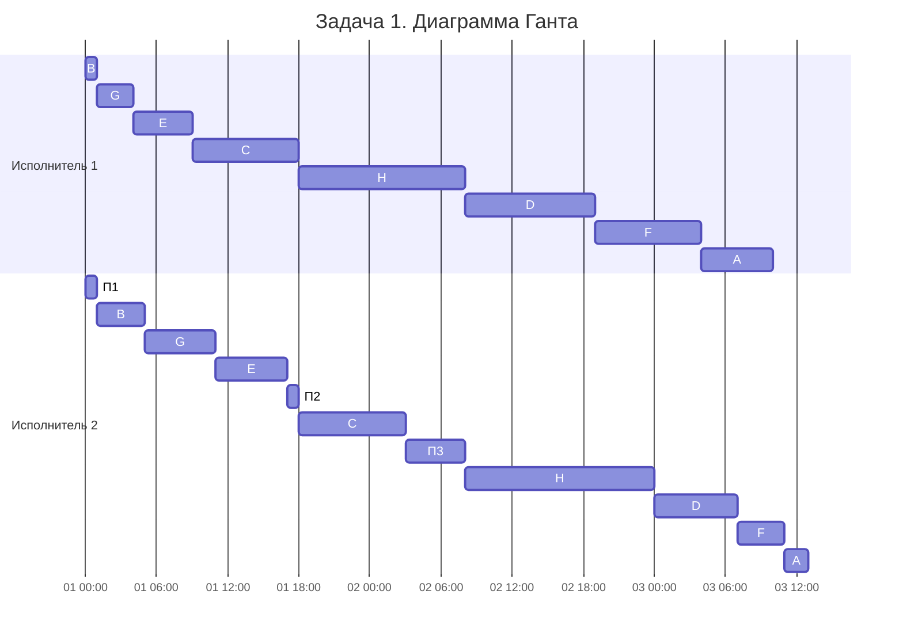
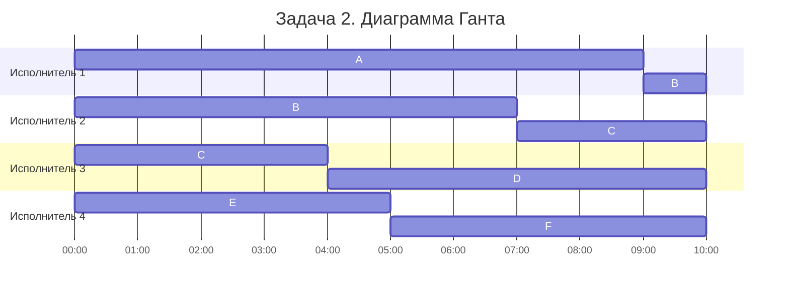

# Задание 8
## Вариант 3

## Задача 1

### Условие

Есть 8 заданий: A, B, C, D, E, F, G, H.
У каждого задания 2 последовательных этапа:
- 1-й этап выполняет только исполнитель 1;
- 2-й этап выполняет только исполнитель 2.

Прерывания запрещены: если этап начат, он выполняется до конца.
Нужно построить расписание минимальной общей длительности.

### Данные

| Задание | A | B | C | D | E | F | G | H |
| --- | --- | --- | --- | --- | --- | --- | --- | --- |
| Первый этап | 6 | 1 | 9 | 11 | 5 | 9 | 3 | 14 |
| Второй этап | 2 | 4 | 9 | 7 | 6 | 4 | 6 | 16 |

### Какой алгоритм используем и почему

Проверим условие по восьми характеристикам модельной задачи:

1. **Количество работ** — произвольное, но известно в начале построения расписания (8 заданий).
2. **Длительности работ** — у каждого задания свои длительности этапов.
3. **Одновременное выполнение** — задания независимы друг от друга (на конвейер можно подать любое), внутри задания этапы связаны строгой предшественностью: второй этап нельзя начать, пока не закончен первый этап этого же задания.
4. **Прерывания** — начатый этап выполняется до конца - запрещены.
5. **Количество исполнителей** — ровно 2.
6. **Универсальность исполнителей** — каждый исполнитель специализирован на своём этапе.
7. **Идентичность исполнителей** — по производительности и другим характеристикам не отличаются.
8. **Критерий оптимальности** — минимальная общая длительность расписания.

Получается конвейерная задача. Два этапа у каждой работы, ровно два специализированных исполнителя, прерывания запрещены. Для неё существует алгоритм Джонсона — полиномиальный, со строгим доказательством оптимальности.

Сквозное ограничение задачи: в каждый момент времени над одним заданием работает ровно один исполнитель, задание не может обрабатываться на двух станках одновременно.

### Алгоритм Джонсона

1. Разбить все работы на две группы:
   - **группа 1** — работы, у которых первый этап короче или равен второму (работы с равными этапами тоже идут в первую группу);
   - **группа 2** — остальные работы (первый этап длиннее второго).
2. Группу 1 отсортировать **по возрастанию длительности первого этапа**.
   Группу 2 отсортировать **по убыванию длительности второго этапа**.
3. Склеить списки.

Принцип работы сортировки. Работа с самым коротким первым этапом стартует первой — так минимизируется начальный простой второго исполнителя. Работа с самым коротким вторым этапом оказывается последней.

### Строим порядок

Разбиваем на группы (сравниваем этапы внутри каждого задания):

| Задание | 1-й этап | 2-й этап | Сравнение | Группа |
| --- | :-: | :-: | :-: | :-: |
| A | 6 | 2 | 6 > 2 | 2 |
| B | 1 | 4 | 1 ≤ 4 | 1 |
| C | 9 | 9 | равны → в первую группу | 1 |
| D | 11 | 7 | 11 > 7 | 2 |
| E | 5 | 6 | 5 ≤ 6 | 1 |
| F | 9 | 4 | 9 > 4 | 2 |
| G | 3 | 6 | 3 ≤ 6 | 1 |
| H | 14 | 16 | 14 ≤ 16 | 1 |

Группа 1 = {B, G, E, C, H}, сортируем по возрастанию первого этапа:
B(1) → G(3) → E(5) → C(9) → H(14). Уже в порядке.

Группа 2 = {A, D, F}, сортируем по убыванию второго этапа:
D(7) → F(4) → A(2).

Склеиваем:

**B → G → E → C → H → D → F → A**

### Считаем расписание

Исполнитель 1 выполняет задания подряд в найденном порядке.

#### Исполнитель 1

| Задание | Начало | Конец |
| --- | --- | --- |
| B | 0 | 1 |
| G | 1 | 4 |
| E | 4 | 9 |
| C | 9 | 18 |
| H | 18 | 32 |
| D | 32 | 43 |
| F | 43 | 52 |
| A | 52 | 58 |

#### Исполнитель 2

Он может начать задание только когда задание уже прошло первый этап и сам исполнитель свободен.

| Задание | Начало | Конец | Пояснение |
| --- | --- | --- | --- |
| B | 1 | 5 | ждал окончания 1-го этапа B (0–1) |
| G | 5 | 11 | G готова к 4, но исполнитель был занят B до 5 |
| E | 11 | 17 | E готова к 9, исполнитель был занят G до 11 |
| C | 18 | 27 | C готова к 18 |
| H | 32 | 48 | ждал окончания 1-го этапа H (18–32) |
| D | 48 | 55 | D готова к 43, исполнитель был занят H до 48 |
| F | 55 | 59 | F готова к 52, исполнитель был занят D до 55 |
| A | 59 | 61 | A готова к 58, исполнитель был занят F до 59 |

Сводное расписание:

| Задание | Исполнитель 1 | Исполнитель 2 |
| --- | --- | --- |
| B | 0–1 | 1–5 |
| G | 1–4 | 5–11 |
| E | 4–9 | 11–17 |
| C | 9–18 | 18–27 |
| H | 18–32 | 32–48 |
| D | 32–43 | 48–55 |
| F | 43–52 | 55–59 |
| A | 52–58 | 59–61 |

Простои исполнителя 2: 0–1, 17–18, 27–32. У исполнителя 1 есть хвостовой простой 58–61. Ни одно задание не обрабатывается на двух станках одновременно: интервалы одного задания на двух исполнителях не пересекаются.

Проверим длительность ещё одним способом. Исполнитель 1 работает 58 единиц времени и простаивает в конце с 58 до 61. Получается 58 + 3 = 61. Можно посчитать и по исполнителю 2: он занят 54 единицы, а его простои — 0–1, 17–18 и 27–32. Итого 54 + 1 + 1 + 5 = 61. Всё сходится.

### Ответ по задаче 1

**Минимальная длительность расписания: 61 условных единиц.**
Оптимальный порядок: **B → G → E → C → H → D → F → A** (оптимальных порядков может быть несколько с той же длиной 61; алгоритм Джонсона даёт этот).

### Диаграмма Ганта

(П1, П2, П3 — простои исполнителя 2: 0–1, 17–18, 27–32.)

### Интерпретация: производство микросхем

На заводе нужно обработать 8 партий микросхем (A–H). Каждая партия проходит два обязательных этапа строго по порядку. Сперва фотолитографию на станке 1, после травление на станке 2. Каждый станок обрабатывает только одну партию за раз. Останавливать процесс посередине нельзя и партии ничем не зависят друг от друга, поэтому порядок их запуска можно выбирать. Нужно подать партии на конвейер в таком порядке, чтобы все прошли оба этапа как можно быстрее.

---

## Задача 2

### Условие

У нас 6 независимых заданий и 4 исполнителя. Все исполнители одинаковые и могут брать любую работу. В отличие от первой задачи, здесь работу разрешено прерывать и потом продолжать.

Надо составить расписание, чтобы закончить все задания за минимальное время.

### Данные

| Задание | A | B | C | D | E | F |
| --- | --- | --- | --- | --- | --- | --- |
| Длительность | 9 | 8 | 7 | 6 | 5 | 5 |

### Какой алгоритм используем и почему

Сначала разберём задачу по тем же восьми характеристикам:

1. **Количество работ** — всего 6, все известны заранее.
2. **Длительности работ** — у каждой работы одна длительность, отдельных этапов нет. Время выполнения у всех разное.
3. **Одновременное выполнение** — работы друг от друга не зависят. Можно запускать несколько сразу, если есть свободные исполнители.
4. **Прерывания** — разрешены. Можно остановить работу и отдать её другому исполнителю, который продолжит с того же места. Время на передачу не тратим.
5. **Количество исполнителей** — 4.
6. **Универсальность исполнителей** — любой может выполнить любую из шести работ.
7. **Идентичность исполнителей** — все работают с одинаковой скоростью.
8. **Критерий оптимальности** — хотим минимальное время завершения всех работ. Отдельно уменьшать количество прерываний или простоев не требуется.

Здесь подходит **ленточная стратегия**. Работы независимы, исполнители одинаковые, а задания можно прерывать. Это как раз те условия, при которых её можно использовать.

### Считаем минимальное время

Сначала сложим длительности всех работ:

9 + 8 + 7 + 6 + 5 + 5 = **40**

Теперь надо понять, за какое минимальное время четыре исполнителя вообще могут справиться.

Самая длинная работа — A, она занимает 9 единиц времени. Меньше 9 получить не получится, потому что одну работу не могут одновременно делать два исполнителя.

Но есть и второе ограничение. Всего у нас 40 единиц работы и 4 исполнителя. Значит, даже если нагрузить всех равномерно, понадобится как минимум 40 / 4 = 10 единиц времени.

Берём большее из двух значений:

**T\* = max(9, 10) = 10.**

Получается нижняя граница — 10. Если сможем уложить в неё все задания, значит расписание оптимальное.

### Строим расписание ленточной стратегией

Берём задания в том же порядке, что и в условии: A, B, C, D, E, F. Менять их местами не нужно.

Мысленно складываем все работы в одну длинную ленту. Её общая длина 40. Теперь разрежем её на 4 одинаковые части по 10 единиц. Самая длинная работа занимает 9, то есть целиком длиннее одного куска ничего нет.

| Кусок | Интервал ленты | Содержимое |
| --- | --- | --- |
| 1 | 0–10 | A целиком (9) + часть B (1) |
| 2 | 10–20 | часть B (7) + часть C (3) |
| 3 | 20–30 | часть C (4) + D целиком (6) |
| 4 | 30–40 | E целиком (5) + F целиком (5) |

Каждый кусок отдаём отдельному исполнителю. Но есть один момент: если работа попала сразу в два куска, её части нельзя выполнять одновременно. Поэтому куски надо расположить по времени так, чтобы они не пересекались для одной и той же работы.

Получаем такое расписание:

#### Исполнитель 1
- A: 0–9
- B: 9–10

#### Исполнитель 2
- B: 0–7
- C: 7–10

#### Исполнитель 3
- C: 0–4
- D: 4–10

#### Исполнитель 4
- E: 0–5
- F: 5–10

Проверим, всё ли сходится. Работа B занимает 7 + 1 = 8 единиц, C — 4 + 3 = 7. Остальные задания тоже выполнены полностью.

При этом одну работу никто не делает одновременно: B сначала выполняет второй исполнитель (0–7), а потом первый (9–10). С работой C такая же история: сначала третий (0–4), потом второй (7–10).

В итоге прерываем только B и C. Это 2 прерывания, то есть меньше допустимой для стратегии границы K−1 = 3. И все четыре исполнителя заняты с 0 до 10, без простоев.

### Ответ по задаче 2

**Минимальная длительность расписания: 10 условных единиц.**

### Диаграмма Ганта

### Интерпретация: разметка аудиозаписей для ИИ

Допустим, мы обучаем модель распознавания речи. Для этого нужно разметить 6 наборов телефонных записей (A–F): отметить участки с речью человека, тишиной и автоответчиком. У нас есть 4 специалиста. Каждый умеет размечать любой набор, а если человек не успел закончить, работу можно передать другому. Тот продолжит с того же места. При этом один набор в конкретный момент размечает только один специалист, иначе пометки могут конфликтовать. Нам остаётся распределить наборы так, чтобы вся разметка закончилась как можно раньше. Для этого и используем ленточную стратегию.

