**Каждое задание выполняется в 2 этапа, сначала 1 и только потом 2!
Можно выполнять независимые задания параллельно!
Прерывать выполнение задания нельзя!**

1) a < b: A, D, E, F, G, H
   b < a: B, C, I

2) I: E, F, D, H, A, G (по возрастанию 1 этапа)
   II: B, C, I (по убыванию 2 этапа)

3) E, F, D, H, A, G, B, C, I (оптимальный порядок)

```mermaid
gantt
    title Оптимальное расписание (Задача 1)
    dateFormat X
    axisFormat %s

    section Исполнитель 1
    E        :e1, 0, 1s
    F        :f1, after e1, 3s
    D        :d1, after f1, 4s
    H        :h1, after d1, 7s
    A        :a1, after h1, 12s
    G        :g1, after a1, 17s
    B        :b1, after g1, 12s
    C        :c1, after b1, 9s
    I        :i1, after c1, 6s
    Простой  :crit, p1, after i1, 5s

    section Исполнитель 2
    Простой  :crit, p2_1, 0, 1s
    E        :e2, after p2_1, 5s
    F        :f2, after e2, 4s
    D        :d2, after f2, 6s
    H        :h2, after d2, 10s
    Простой  :crit, p2_2, after h2, 1s
    A        :a2, after p2_2, 14s
    Простой  :crit, p2_3, after a2, 3s
    G        :g2, after p2_3, 18s
    B        :b2, after g2, 8s
    C        :c2, after b2, 4s
    I        :i2, after c2, 2s
```

**Ответ: 76**

**ИНТЕРПРИТАЦИЯ:
Инженер собирает 9 серверов (\(A\)–\(I\)), после чего системный администратор по очереди и без перерывов ставит на них ПО. Чтобы не допускать простоев, работу начинают с самого быстрого в сборке сервера \(E\) и завершают самым быстрым в настройке сервером \(I\), укладываясь в минимальные 76 часов.**

**Нельзя выполнять независимые задания параллельно!
Прерывать выполнение задания можно!**

T = max(14, (14+6+5+4+3+2)/4) = max(14, 34/4) = 14

```mermaid
gantt
    title Оптимальное расписание (Задача 2)
    dateFormat X
    axisFormat %s
    tickInterval 1second

    section Исполнитель 1
    A        :a, 0, 14s

    section Исполнитель 2
    B        :b, 0, 6s
    C        :c, after b, 5s
    D (1 ч.) :d1, after c, 3s

    section Исполнитель 3
    D (2 ч.) :d2, 0, 1s
    E        :e, after d2, 3s
    F        :f, after e, 2s
    Простой  :crit, p3, after f, 8s

    section Исполнитель 4
    Простой  :crit, p4, 0, 14s
```

**Ответ: 14**

**ИНТЕРПРИТАЦИЯ:
4 одинаковых специалиста разбирают 6 независимых заявок (\(A\)–\(F\)), которые можно ставить на паузу и передавать коллегам, но нельзя делать вдвоем одновременно. Самая долгая заявка \(A\) определяет минимальный общий срок в 14 часов, поэтому первый сотрудник полностью берет её, второй и третий делят между собой задачу \(D\) и остальные заявки, а четвертый остается в резерве.**
