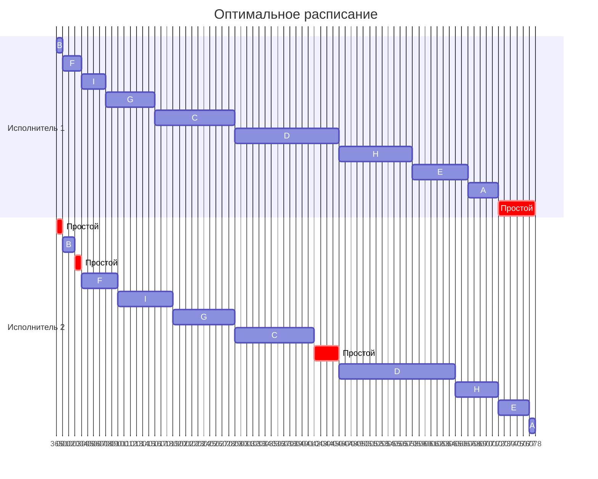

# Задание №8 Вариант 7. Оптимальное расписание

## Задача 1

### Постановка задачи 1

Имеется 9 независимых заданий, каждое из которых состоит из двух последовательных этапов, и 2 исполнителя: первый выполняет только первый этап каждого задания, второй — только второй. Прерывания запрещены.

Длительности этапов:

| | $A$ | $B$ | $C$ | $D$ | $E$ | $F$ | $G$ | $H$ | $I$ |
| --- | :---: | :---: | :---: | :---: | :---: | :---: | :---: | :---: | :---: |
| Первый этап | 5 | 1 | 13 | 17 | 9 | 3 | 8 | 12 | 4 |
| Второй этап | 1 | 2 | 13 | 19 | 5 | 6 | 10 | 7 | 9 |

Постройте расписание выполнения всех заданий в кратчайшие сроки.

### Решение задачи 1

По условию задачи имеется два исполнителя, запрещены прерывания, каждое задание состоит из двух последовательных этапов и каждый исполнитель выполняет только свой этап задания. Из этого делаем вывод что тип задачи: конвеер. Для решения задачи такого типа необходимо применить алгоритм Джонсона.

В первую очередь необходимо разделить задания на две группы. В первой группе будут те задания, длительность второго этапа которых больше или равна длительности первого этапа. Отсортируем эти задания по **возрастанию длительности первого этапа**.

| | $B$ | $F$ | $I$ | $G$ | $C$ | $D$ |
| --- | :---: | :---: | :---: | :---: | :---: | :---: |
| Первый этап | 1 | 3 | 4 | 8 | 13 | 17 |
| Второй этап | 2 | 6 | 9 | 10 | 13 | 19 |

Во второй группе будут те задания, длительность второго этапа которых меньше длительности первого этапа. Отсортируем эти задания по **убыванию длительности второго этапа**.

| | $H$ | $E$ | $A$ |
| --- | :---: | :---: | :---: |
| Первый этап | 12 | 9 | 5 |
| Второй этап | 7 | 5 | 1 |

Для получения оптимального расписания необходимо выполнить сначала все задачи из первой группы в полученном порядке, затем - из второй группы в полученном порядке. Оптимальный порядок выполнения всех заданий: **B → F → I → G → C → D → H → E → A**

Время начала следующего задания для первого исполнителя равно времени завершения выполнения предыдущего задания. Для второго исполнителя - время завершения предыдущего задания или время завершения выполнения текущего задания первым исполнителем, выбирается большая величина. Для вычислений заполним таблицу, включающую время начала для каждого этапа для каждого исполнителя в оптимальном порядке.

| | $B$ | $F$ | $I$ | $G$ | $C$ | $D$ | $H$ | $E$ | $A$ |
| --- | :---: | :---: | :---: | :---: | :---: | :---: | :---: | :---: | :---: |
| Первый этап | 1 | 3 | 4 | 8 | 13 | 17 | 12 | 9 | 5 |
| Время выполнения первого этапа | 0–1 | 1–4 | 4–8 | 8–16 | 16–29 | 29–46 | 46–58 | 58–67 | 67–72 |
| Второй этап | 2 | 6 | 9 | 10 | 13 | 19 | 7 | 5 | 1 |
| Время выполнения второго этапа | 1–3 | 4–10 | 10–19 | 19–29 | 29–42 | 46–65 | 65–72 | 72–77 | 77–78 |

Итоговое время выполнения всех заданий - 78 единиц

На основании таблицы можно составить диаграмму Ганта. За условную единицу времени принят 1 день.

На диаграмме наглядно видно, что второй исполнитель будет трижды простаивать (1, 1 и 4 единицы), ожидая завершения выполнения задания первым исполнителем. А первый исполнитель будет простаивать 6 единиц времени в конце расписания.

### Интерпретация задачи 1
В команде есть 2 разработчика (бэкендер и фронтендер). Нужно реализовать 9 независимых задач, каждая из которых предполагает разработку API, который затем должен использоваться для ввода/отрисовки данных в веб-интерфейсе. Каждый разработчик может выполнять только одну задачу одновременно, прерывание начатой работы и переключение на другую задачу не допускаются.

При этом фронтендер не может приступить к выполнению своей части задачи, пока необходимый API не будет полностью готов. Таким образом, каждая задача сначала выполняется бэкендером, и только после завершения серверной части передается фронтендеру.

## Задача 2

### Постановка задачи 2

Имеется 7 независимых заданий и 4 универсальных исполнителя. Прерывания допускаются.

Длительности заданий:

| | $A$ | $B$ | $C$ | $D$ | $E$ | $F$ | $G$ |
| --- | :---: | :---: | :---: | :---: | :---: | :---: | :---: |
| Длительность | 19 | 7 | 6 | 5 | 4 | 3 | 2 |

Постройте расписание выполнения всех заданий в кратчайшие сроки.

### Решение задачи 2

Данная задача относится к классу **модельных задач теории расписаний**. Проанализируем её параметры:
1. **Количество заданий произвольно:** в данной задаче \(n = 7\) заданий.
2. **Каждое задание имеет свою длительность:** длительности заданы в таблице (от 2 до 19).
3. **Задания независимы:** их можно выполнять одновременно (допускается распараллеливание).
4. **Прерывания разрешены:** это позволяет применить ленточную стратегию.
5. **Количество исполнителей произвольно, но фиксировано:** 4 исполнителя.
6. **Исполнители универсальны:** каждый может выполнить любое задание.
7. **Производительность, оплата труда и т.п. не учитываются:** все исполнители считаются одинаково эффективными.
8. **Требуется построить расписание в кратчайшие сроки:** цель — минимизировать общее время выполнения (найти $T_{\text{opt}}$).

Поскольку прерывания разрешены, а исполнители универсальны, мы можем применить **ленточную стратегию**. Для n независимых заданий и k универсальных исполнителей длина кратчайшего расписания вычисляется по формуле:

$$
T_{\text{opt}} = \max \left\lbrace t_1, \dots, t_n, \frac{t_1 + \dots + t_n}{k} \right\rbrace
$$

Эта формула показывает, что время выполнения не может быть меньше самого длинного задания и не может быть меньше средней загрузки исполнителей. При разрешенных прерываниях обе эти оценки достижимы.

### Шаг 1. Вычисление $T_{\text{opt}}$

Суммарная длительность всех работ: $$19 + 7 + 6 + 5 + 4 + 3 + 2 = 46$$.
Количество исполнителей: $$k = 4$$.
Средняя загрузка одного исполнителя: $$46 / 4 = 11.5$$.
Самое длинное задание: $$A = 19$$.
Так как $$19 > 11.5$$, то:

$$
T_{\text{opt}} = \max \left\lbrace 19, 7, 6, 5, 4, 3, 2, \frac{19 + 7 + 6 + 5 + 4 + 3 + 2}{4} \right\rbrace = \max(19, 11.5) = 19
$$

### Шаг 2. Формирование «ленты»

Согласно методу, мы выстраиваем все задания в одну очередь (ленту) и «режем» её на фрагменты длиной ровно $$T_{\text{opt}} = 19$$. Каждый такой фрагмент — это работа одного исполнителя.
*Лента задач:* **A(19) → B(7) → C(6) → D(5) → E(4) → F(3) → G(2).**

### Шаг 3. Распределение задач и прерывания

- **1-й исполнитель:** забирает задание \(A=19\). Лента обрезана ровно на отметке 19.
- **2-й исполнитель:** берет \(B(7) + C(6) + D(5) = 18\). Ему не хватает 1 единицы времени до конца ленты (19). Поэтому он берет первый кусок задания E равный 1. Итого: \(18 + 1 = 19\).
- **3-й исполнитель:** забирает остаток задания E равный 3, затем \(F(3) + G(2) = 8\). Ему не хватает 11 единиц до 19. 
- **4-й исполнитель:** задач для него не хватило, значит, можно не использовать. 

### Итоговая таблица

<table border="1" style="border-collapse: collapse; width: 100%; font-family: serif; font-size: 16px;">
  <tr>
    <td width="150" align="left" style="padding: 8px; background-color: #f9f9f9;">
      I исполнитель
    </td>
    <td colspan="19" align="center" style="padding: 8px;">
      <i>A</i>=19
    </td>
  </tr>
  <tr>
    <td align="left" style="padding: 8px; background-color: #f9f9f9;">
      II исполнитель
    </td>
    <td colspan="7" align="center" style="padding: 8px;">
      <i>B</i>=7
    </td>
    <td colspan="6" align="center" style="padding: 8px;">
      <i>C</i>=6
    </td>
    <td colspan="5" align="center" style="padding: 8px;">
      <i>D</i>=5
    </td>
    <td align="center" style="padding: 8px;">
      <i>E</i>=1
    </td>
  </tr>
  <tr>
    <td align="left" style="padding: 8px; background-color: #f9f9f9;">
      III исполнитель
    </td>
    <td colspan="3" align="center" style="padding: 8px;">
      <i>E</i>=3
    </td>
    <td colspan="3" align="center" style="padding: 8px;">
      <i>F</i>=3
    </td>
    <td colspan="2" align="center" style="padding: 8px;">
      <i>G</i>=2
    </td>
    <td colspan="11" align="center" style="padding: 8px;">
      —
    </td>
  </tr>
  <tr>
    <td align="left" style="padding: 8px; background-color: #f9f9f9;">
      IV исполнитель
    </td>
    <td colspan="19" align="center" style="padding: 8px;">
      —
    </td>
  </tr>
</table>

### Интерпретация задачи 2
В команде есть 4 фулстэк-разработчика. Нужно реализовать 7 независимых задач, каждая из которых предполагает разработку определенной части функциональности веб-приложения. Любой разработчик может выполнять любую из задач, над одной задачей одновременно может работать только один разработчик.

Разработчики могут прерывать выполнение текущих задач и переключаться на другие, при этом незавершенная задача может быть передана другому разработчику, который продолжит ее выполнение с того места, где остановился предыдущий.
