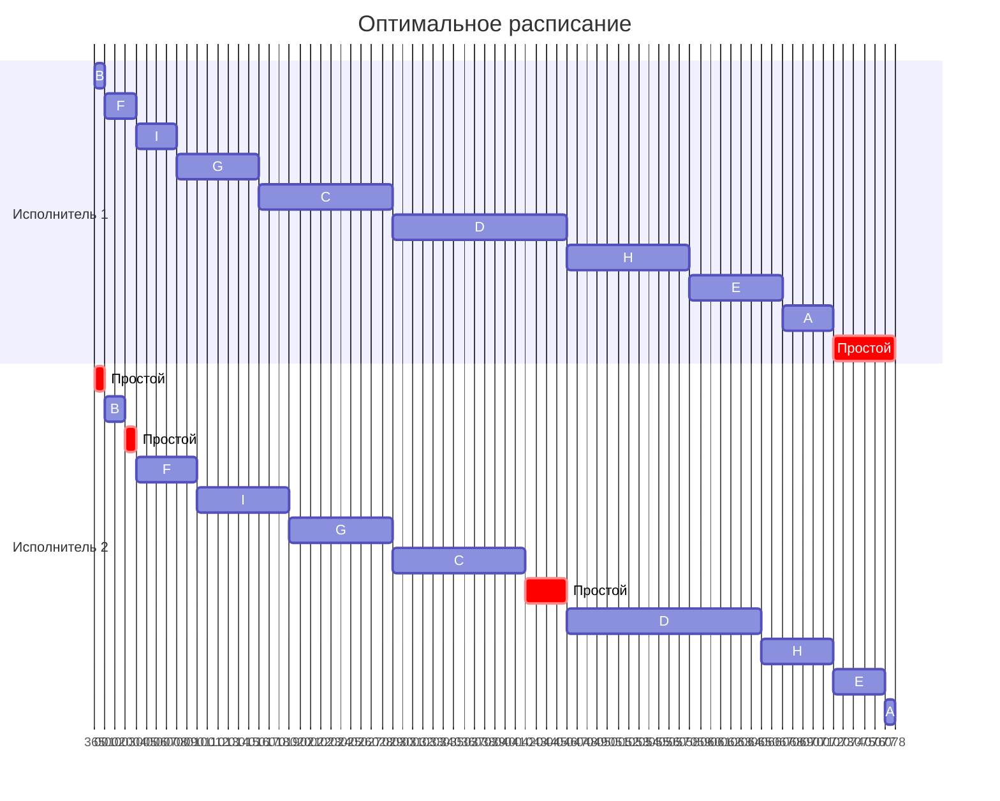

# Задание №8 Вариант 7. Оптимальное расписание

## Задача 1

### Постановка задачи 1

Имеется 9 независимых заданий, каждое из которых состоит из двух последовательных этапов, и 2 исполнителя: первый выполняет только первый этап каждого задания, второй — только второй. Прерывания запрещены.

Длительности этапов:

| | $A$ | $B$ | $C$ | $D$ | $E$ | $F$ | $G$ | $H$ | $I$ |
| --- | :---: | :---: | :---: | :---: | :---: | :---: | :---: | :---: | :---: |
| Первый этап | 5 | 1 | 13 | 17 | 9 | 3 | 8 | 12 | 4 |
| Второй этап | 1 | 2 | 13 | 19 | 5 | 6 | 10 | 7 | 9 |

Постройте расписание выполнения всех заданий в кратчайшие сроки.

### Решение задачи 1

По условию задачи имеется два исполнителя, запрещены прерывания, каждое задание состоит из двух последовательных этапов и каждый исполнитель выполняет только свой этап задания. Из этого делаем вывод что тип задачи: конвеер. Для решения задачи такого типа необходимо применить алгоритм Джонсона.

В первую очередь необходимо разделить задания на две группы. В первой группе будут те задания, длительность второго этапа которых больше или равна длительности первого этапа. Отсортируем эти задания по **возрастанию длительности первого этапа**.

| | $B$ | $F$ | $I$ | $G$ | $C$ | $D$ |
| --- | :---: | :---: | :---: | :---: | :---: | :---: |
| Первый этап | 1 | 3 | 4 | 8 | 13 | 17 |
| Второй этап | 2 | 6 | 9 | 10 | 13 | 19 |

Во второй группе будут те задания, длительность второго этапа которых меньше длительности первого этапа. Отсортируем эти задания по **убыванию длительности второго этапа**.

| | $H$ | $E$ | $A$ |
| --- | :---: | :---: | :---: |
| Первый этап | 12 | 9 | 5 |
| Второй этап | 7 | 5 | 1 |

Для получения оптимального расписания необходимо выполнить сначала все задачи из первой группы в полученном порядке, затем - из второй группы в полученном порядке. Оптимальный порядок выполнения всех заданий: **B → F → I → G → C → D → H → E → A**

Время начала следующего задания для первого исполнителя равно времени завершения выполнения предыдущего задания. Для второго исполнителя - время завершения предыдущего задания или время завершения выполнения текущего задания первым исполнителем, выбирается большая величина. Для вычислений заполним таблицу, включающую время начала для каждого этапа для каждого исполнителя в оптимальном порядке.

| | $B$ | $F$ | $I$ | $G$ | $C$ | $D$ | $H$ | $E$ | $A$ |
| --- | :---: | :---: | :---: | :---: | :---: | :---: | :---: | :---: | :---: |
| Первый этап | 1 | 3 | 4 | 8 | 13 | 17 | 12 | 9 | 5 |
| Время выполнения первого этапа | 0–1 | 1–4 | 4–8 | 8–16 | 16–29 | 29–46 | 46–58 | 58–67 | 67–72 |
| Второй этап | 2 | 6 | 9 | 10 | 13 | 19 | 7 | 5 | 1 |
| Время выполнения второго этапа | 1–3 | 4–10 | 10–19 | 19–29 | 29–42 | 46–65 | 65–72 | 72–77 | 77–78 |

Итоговое время выполнения всех заданий - 78 единиц

На основании таблицы можно составить диаграмму Ганта. За условную единицу времени принят 1 день.

На диаграмме наглядно видно, что второй исполнитель будет трижды простаивать (1, 1 и 4 единицы), ожидая завершения выполнения задания первым исполнителем. А первый исполнитель будет простаивать 6 единиц времени в конце расписания.

## Задача 2

### Постановка задачи 2

Имеется 7 независимых заданий и 4 универсальных исполнителя. Прерывания допускаются.

Длительности заданий:

| | $A$ | $B$ | $C$ | $D$ | $E$ | $F$ | $G$ |
| --- | :---: | :---: | :---: | :---: | :---: | :---: | :---: |
| Длительность | 19 | 7 | 6 | 5 | 4 | 3 | 2 |

Постройте расписание выполнения всех заданий в кратчайшие сроки.

### Решение задачи 2
