Задание №8. Вариант 6

Задача 1.

Имеется 6 независимых заданий и 3 универсальных исполнителя. Прерывания
допускаются.

| Задание      | $A$ | $B$ | $C$ | $D$ | $E$ | $F$ |
| :----------- | :-: | :-: | :-: | :-: | :-: | :-: |
| Длительность | 11  | 8   | 7   | 6   | 5   | 2   |

Условие задачи полностью соответствует классической задаче теории расписаний $P \mid pmtn \mid C_{\max}$:

  - имеется $m = 3$ идентичных параллельных обслуживающих прибора
  - множество независимых требований с известными длительностями $p_j$;
  - прерывания выполнения заданий разрешены ($pmtn$);
  - критерий — минимизация времени завершения всех заданий ($C_{\max}$).

Для решения данной задачи оптимальным является ленточный алгоритм Макнотона.

Длительность расписания снизу ограничена двумя величинами:

1.  Максимальной длительностью отдельного задания: ни одно задание не может выполняться параллельно само с собой, поэтому $T \ge \max\limits_j p_j$.
2.  Средней загрузкой исполнителей: суммарная работа делится на $m$ исполнителей, поэтому $T \ge \frac{1}{m} \sum\limits_{j} p_j$.

Следовательно, минимально возможная длина оптимального расписания:

$$
T = \max \left( \max_{j} p_j, \; \frac{1}{m} \sum_{j=1}^n p_j \right)
$$

Алгоритм Макнотона гарантирует построение расписания ровно за время $T$ без временных пересечений частей одного и того же задания.
Ход решения

1.  Посчитаем суммарную трудоёмкость всех заданий:
    $\sum_{j=1}^6 p_j = 11 + 8 + 7 + 6 + 5 + 2 = 39$
2.  Найдём среднюю нагрузку на одного исполнителя ($m = 3$): $\frac{39}{3} = 13$
3.  Максимальная длительность задачи: $\max_j p_j = p_A = 11$
4.  Минимально возможное время выполнения: $T = \max(11, 13) = 13$ (Так как средняя нагрузка равна 13, все 3 исполнителя будут работать без простоев).

Расположим задания последовательно на единой временной оси $[0, 39]$:

  - $A$: $[0, 11]$
  - $B$: $[11, 19]$
  - $C$: $[19, 26]$
  - $D$: $[26, 32]$
  - $E$: $[32, 37]$
  - $F$: $[37, 39]$

Разрежем полученную полосу на 3 интервала длиной по 13 единиц:

  - Исполнитель 1 (интервал ленты $[0, 13]$):

      - Задание $A$ целиком: $[0, 11]$ (11 ч)
      - Первая часть задания $B$ ($B_1$): $[11, 13]$ (2 ч)
  - Исполнитель 2 (интервал ленты $[13, 26]$):

      - Вторая часть задания $B$ ($B_2$): $[0, 6]$ (6 ч)
      - Задание $C$ целиком: $[6, 13]$ (7 ч) (Проверка корректности прерывания:
        часть $B_1$ выполняется в период с 11 по 13, а часть $B_2$ — с 0 по 6.
        Временные интервалы не пересекаются, исполнители не выполняют задачу $B$
        одновременно).
  - Исполнитель 3 (интервал ленты $[26, 39]$):

      - Задание $D$ целиком: $[0, 6]$ (6 ч)
      - Задание $E$ целиком: $[6, 11]$ (5 ч)
      - Задание $F$ целиком: $[11, 13]$ (2 ч)

Диаграмма Ганта

```mermaid
gantt
    title Ленточная стратегия Макнотона (T = 13)
    dateFormat HH:mm
    axisFormat %H:%M
    section Исполнитель 1
    A        :a1, 00:00, 11h
    B (ч. 1) :b1, after a1, 2h
    section Исполнитель 2
    B (ч. 2) :b2, 00:00, 6h
    C        :c1, after b2, 7h
    section Исполнитель 3
    D        :d1, 00:00, 6h
    E        :e1, after d1, 5h
    F        :f1, after e1, 2h
```

Итоговая длительность: 13.

Интерпретация (Задача 1)

Имеется 3-ядерный процессор и 6 вычислительных задач с фиксированным объёмом вычислений.
Операционная система поддерживает вытесняющую многозадачность.
Требуется распределить задачи по ядрам так, чтобы вся пачка завершилась за минимальное время.

Задача 2

Имеется 8 независимых заданий, каждое из которых состоит из двух
последовательных этапов, и 2 исполнителя: первый выполняет только первый этап
каждого задания, второй — только второй. Прерывания запрещены.

| Задание             | $A$ | $B$ | $C$ | $D$ | $E$ | $F$ | $G$ | $H$ |
| :------------------ | :-: | :-: | :-: | :-: | :-: | :-: | :-: | :-: |
| Первый этап ($a_i$) | 5   | 14  | 6   | 8   | 3   | 2   | 11  | 9   |
| Второй этап ($b_i$) | 9   | 16  | 1   | 8   | 4   | 7   | 5   | 3   |

Выбор и обоснование алгоритма

Условие задачи ссоответствует классической задаче конвейерного типа для
двух станков $F2 \mid no-preemption \mid C_{\max}$:

  - 2 специализированных исполнителя, маршрут для всех заданий строго
    фиксирован: $1 \to 2$;
  - прерывания этапов запрещены;
  - критерий — минимизация общего времени завершения всех операций ($C_{\max}$).

Для нахождения оптимального порядка подачи заданий применяется алгоритм
Джонсона.

Обоснование минимизации: Первый исполнитель работает непрерывно время $\sum a_i$.
Общая длительность расписания определяется временем завершения второго
исполнителя. Чтобы минимизировать простой второго исполнителя:

1.  Задания с коротким первым этапом ($a_i \le b_i$) нужно ставить в начало: они
    быстрее запускают в работу второго исполнителя и создают ему запас задач.
2.  Задания с коротким вторым этапом ($a_i > b_i$) нужно сдвигать в самый конец:
    чтобы второй исполнитель успел доделать работу как можно скорее после того,
    как первый исполнитель закончит последний первый этап.

Ход решения

Разделим задачи на две группы:

  - Группа I: задания, у которых $a_i \le b_i$ (задачи с равными этапами $a_i = b_i$
    относим к I группе);
  - Группа II: задания, у которых $a_i > b_i$.

| Задание             | $A$ | $B$ | $C$ | $D$ | $E$ | $F$ | $G$ | $H$ |
| :------------------ | :-: | :-: | :-: | :-: | :-: | :-: | :-: | :-: |
| Первый этап ($a_i$) | 5   | 14  | 6   | 8   | 3   | 2   | 11  | 9   |
| Второй этап ($b_i$) | 9   | 16  | 1   | 8   | 4   | 7   | 5   | 3   |
| Группа              | I   | I   | II  | I   | I   | I   | II  | II  |

Сортировка Группы I (по возрастанию $a_i$)

В группу I вошли задания: $A(5, 9)$, $B(14, 16)$, $D(8, 8)$, $E(3, 4)$, $F(2, 7)$.

Отсортированная Группа I:

| Задание     | $F$ | $E$ | $A$ | $D$ | $B$ |
| :---------- | :-: | :-: | :-: | :-: | :-: |
| Первый этап | 2   | 3   | 5   | 8   | 14  |
| Второй этап | 7   | 4   | 9   | 8   | 16  |

Сортировка Группы II (по убыванию $b_i$)

В группу II вошли задания: $C(6, 1)$, $G(11, 5)$, $H(9, 3)$.

Отсортированная Группа II:

| Задание     | $G$ | $H$ | $C$ |
| :---------- | :-: | :-: | :-: |
| Первый этап | 11  | 9   | 6   |
| Второй этап | 5   | 3   | 1   |

Итоговый порядок очереди (Группа I, затем Группа II):

$$
F \longrightarrow E \longrightarrow A \longrightarrow D \longrightarrow B \longrightarrow G \longrightarrow H \longrightarrow C
$$

Полная таблица расписания:

| Порядок     | $F$ | $E$ | $A$ | $D$ | $B$ | $G$ | $H$ | $C$ |
| :---------- | :-: | :-: | :-: | :-: | :-: | :-: | :-: | :-: |
| Первый этап | 2   | 3   | 5   | 8   | 14  | 11  | 9   | 6   |
| Второй этап | 7   | 4   | 9   | 8   | 16  | 5   | 3   | 1   |
| Группа      | I   | I   | I   | I   | I   | II  | II  | II  |

Построение временного графика

Рассчитаем моменты старта и окончания по исполнителям:

  - Первый исполнитель работает непрерывно:

      - $F$: $[0, 2]$
      - $E$: $[2, 5]$
      - $A$: $[5, 10]$
      - $D$: $[10, 18]$
      - $B$: $[18, 32]$
      - $G$: $[32, 43]$
      - $H$: $[43, 52]$
      - $C$: $[52, 58]$
      - Суммарное время работы 1-го исполнителя: $\sum a_i = 58$.

  - Второй исполнитель (начинает задачу, как только она готова на 1-м этапе и
    сам исполнитель свободен):

      - $F$: готов в 2 $\to$ выполняется $[2, 9]$ (простой 0–2)
      - $E$: готов в 5, исполнитель свободен в 9 $\to$ выполняется $[9, 13]$
      - $A$: готов в 10, исполнитель свободен в 13 $\to$ выполняется $[13, 22]$
      - $D$: готов в 18, исполнитель свободен в 22 $\to$ выполняется $[22, 30]$
      - $B$: готов в 32, исполнитель освободился в 30 $\to$ выполняется $[32, 48]$
        (простой 30–32)
      - $G$: готов в 43, исполнитель занят до 48 $\to$ выполняется $[48, 53]$
      - $H$: готов в 52, исполнитель занят до 53 $\to$ выполняется $[53, 56]$
      - $C$: готов в 58, исполнитель освободился в 56 $\to$ выполняется $[58, 59]$
        (простой 56–58)

Диаграмма Ганта

```mermaid
gantt
    title Алгоритм Джонсона (F2 || Cmax)
    dateFormat HH:mm
    axisFormat %H:%M
    section Первый исполнитель
    F :a1, 00:00, 2h
    E :a2, after a1, 3h
    A :a3, after a2, 5h
    D :a4, after a3, 8h
    B :a5, after a4, 14h
    G :a6, after a5, 11h
    H :a7, after a6, 9h
    C :a8, after a7, 6h
    section Второй исполнитель
    F :b1, after a1, 7h
    E :b2, after b1, 4h
    A :b3, after b2, 9h
    D :b4, after b3, 8h
    B :b5, after a5, 16h
    G :b6, after b5, 5h
    H :b7, after b6, 3h
    C :b8, after a8, 1h
```

Проверка на оптимальность: Первый исполнитель непрерывно отработал $\sum a_i = 58$
часов. Последнее задание $C$ имело минимальный второй этап среди всех заданий
(длительностью 1 час), и оно завершилось в $58 + 1 = 59$.

Итоговая длительность: 59.

Интерпретация (Задача 2)

Автосервис выполняет обслуживание 8 автомобилей.
Работа состоит из двух обязательных последовательных этапов:
1-й этап — мойка и обезжиривание кузова (выполняет мастер №1),
2-й этап — полировка и нанесение керамики (выполняет мастер №2).
Прерывать технологический процесс нельзя.
Требуется определить порядок заезда машин, чтобы весь сервис закрылся как можно быстрее.
