# Задание №8, Вариант 9, команда noname

### Вариант 9:

**Задача 1.** Имеется 9 независимых заданий, каждое из которых состоит из двух последовательных этапов, и 2 исполнителя: первый выполняет только первый этап каждого задания, второй — только второй. Прерывания запрещены.

Длительности этапов:

| | $A$ | $B$ | $C$ | $D$ | $E$ | $F$ | $G$ | $H$ | $I$ |
| --- | :---: | :---: | :---: | :---: | :---: | :---: | :---: | :---: | :---: |
| Первый этап | 4 | 15 | 2 | 12 | 1 | 6 | 10 | 20 | 7 |
| Второй этап | 9 | 15 | 4 | 9 | 6 | 3 | 5 | 20 | 8 |

Постройте расписание выполнения всех заданий в кратчайшие сроки.

**Задача 2.** Имеется 6 независимых заданий и 3 универсальных исполнителя. Прерывания допускаются.

Длительности заданий:

| | $A$ | $B$ | $C$ | $D$ | $E$ | $F$ |
| --- | :---: | :---: | :---: | :---: | :---: | :---: |
| Длительность | 16 | 7 | 5 | 4 | 3 | 2 |

Постройте расписание выполнения всех заданий в кратчайшие сроки.

## Задача 1

Данная задача - конвеерная, для нее есть эффективный алгоритм с помощью алгоритма Джонсона.

Разобьем задания на 2 группы:

- 1-я группа - задания у которых $a_i <= b_i$ в отсортированном порядке по возрастанию первого этапа
$$E(1,6), C(2,4), A(4, 9), I(7,8), B(15,15), H(20,20)$$
- 2-я группа - задания у которых $a_i > b_i$ в отсортированном порядке по убыванию второго этапа
$$D(12,9), G(10,5), F(6, 3)$$

Итоговая таблица:

| | $E$ | $C$ | $A$ | $I$ | $B$ | $H$ | $D$ | $G$ | $F$ |
| --- | :---: | :---: | :---: | :---: | :---: | :---: | :---: | :---: | :---: |
| Первый этап | 1 | 2 | 4 | 7 | 15 | 20 | 112 | 10 | 6 |
| Второй этап | 6 | 4 | 9 | 8 | 15 | 20 | 12 | 10 | 3 |

Диаграмма Ганта:

```mermaid
gantt
    title Вариант 9. Задача 1
    dateFormat X
    axisFormat %s
    
    section Исполнитель 1
    E :e1, 0, 1s
    C :c1, after e1, 2s
    A :a1, after c1, 4s
    I :i1, after a1, 7s
    B :b1, after i1, 15s
    H :h1, after b1, 20s
    D :d1, after h1, 12s
    G :g1, after d1, 10s
    F :f1, after g1, 6s

    section Исполнитель 2
    простой :skip1, 0, 1s
    E :e2, after skip1, 6s
    C :c2, after e2, 4s
    A :a2, after c2, 9s
    I :i2, after a2, 8s
    простой :skip2, after i2, 1s 
    B :b2, after skip2, 15s
    простой :skip3, after b2, 5s
    H :h2, after skip3, 20s
    D :d2, after h2, 9s
    G :g2, after d2, 5s
    F :f2, after g2, 3s
```

Исходя из условия и диаграммы видим, что второй этап всегда является последним, таким образом итоговая минимальная длина равна сумме длин вторых этапов + время простоя: 

$$
1 + 6 + 4 + 9 + 8 + 1 + 15 + 5 + 20 + 9 + 5 + 3 = 86
$$

## Задача 2
Вычисляем оптимальную длину по формуле:

$$
T_{opt} = max(
t_1, t_2, t_3, t_4, t_5, t_6,
\frac{t_1+t_2+t_3+t_4+t_5+t_6}{3}
)
$$

Получаем:

$$
T_{opt} = max(
16, 7, 5, 4, 3, 2,
\frac{16 + 7 + 5 + 4 + 3 + 2}{3}
) = max(
    16, 7, 5, 4, 3, 2, 12.(3)
) = 16
$$

Итоговая минимальная длина - 16

Для построения диаграмы Ганта используем ленточную стратегию - поделим общую длину наших задач на отрезки по 16 - длину самого длинного задания:

```mermaid
gantt
    title Вариант 9. Задача 2
    dateFormat X
    axisFormat %s
    
    section Исполнитель 1
    A :a, 0, 16s
    section Исполнитель 2
    B: b, 0, 7s
    C: c, after b, 5s
    D: d, after c, 4s
    section Исполнитель 3
    E: e, 0, 3s
    F: f, after e, 2s
```

