# Задание №8, Вариант 1, команда paradigm

## Оптимальное расписание: конвейерная задача и ленточная стратегия

## Задача 1

### Условие

Имеется 8 независимых заданий, каждое из которых состоит из двух последовательных этапов, и 2 исполнителя: первый выполняет только первый этап каждого задания, второй - только второй. Прерывания запрещены. Нужно построить расписание выполнения всех заданий в кратчайшие сроки.

Длительности этапов:

| | $A$ | $B$ | $C$ | $D$ | $E$ | $F$ | $G$ | $H$ |
| --- | :---: | :---: | :---: | :---: | :---: | :---: | :---: | :---: |
| Первый этап | 9 | 15 | 4 | 7 | 10 | 2 | 5 | 1 |
| Второй этап | 11 | 15 | 5 | 2 | 7 | 6 | 1 | 3 |

### Алгоритм

Обозначим длительность первого этапа задания $i$ как $a_i$, второго как $b_i$, число заданий $n = 8$.

Исполнители работают как две очереди: во вторую задание попадает только после того, как закончился его первый этап. Поэтому:

- первая очередь не зависит от второй и может работать без простоев, она закончится в момент $\sum a_i$;
- длина всего расписания - это момент окончания второй очереди;
- второй исполнитель простаивает в двух случаях: в самом начале, пока первый делает самое первое задание, и позже, если он «догнал» первого и ждёт, пока тот закончит очередной первый этап.

Значит, нужно выстроить задания так, чтобы второй исполнитель начал работать как можно раньше и никогда не «догонял» первого, а то, что останется ему доделывать после окончания первой очереди, было как можно короче.

Воспользуемся **алгоритмом Джонсона**:

1. Делим задания на две группы: в первую те, у которых $a_i \le b_i$, во вторую остальные ($a_i > b_i$).
2. Сортируем внутри групп: первую по возрастанию $a_i$, вторую по убыванию $b_i$.
3. Выполняем сначала все задания первой группы, затем все задания второй.

Почему это даёт минимальную длительность:

- В первой группе второй этап не короче первого, поэтому второй исполнитель в ней накапливает «запас» работы. Чем короче первые этапы стоят в начале, тем раньше второй исполнитель начнёт работать и тем быстрее накопится запас.
- Во второй группе второй этап короче первого, запас расходуется. Задания с самым коротким вторым этапом ставятся в конец, чтобы после окончания первой очереди второму исполнителю оставалось доделать как можно меньше.

Сопоставление с моделью: две специализированные очереди, один и тот же порядок заданий в обеих, прерывания запрещены, критерий - длина расписания. Это в точности постановка модельной задачи для алгоритма Джонсона.

### Решение

**Разделим задания на группы** (сравниваем $a_i$ и $b_i$):

| | $A$ | $B$ | $C$ | $D$ | $E$ | $F$ | $G$ | $H$ |
| --- | :---: | :---: | :---: | :---: | :---: | :---: | :---: | :---: |
| Первый этап | 9 | 15 | 4 | 7 | 10 | 2 | 5 | 1 |
| Второй этап | 11 | 15 | 5 | 2 | 7 | 6 | 1 | 3 |
| Группа | I | I | I | II | II | I | II | I |

Задание $B$ имеет равные этапы. Такие задания можно отнести к любой группе, отнесём к первой.

**Отсортируем первую группу** (по возрастанию $a_i$):

| | $H$ | $F$ | $C$ | $A$ | $B$ |
| --- | :---: | :---: | :---: | :---: | :---: |
| Первый этап | 1 | 2 | 4 | 9 | 15 |
| Второй этап | 3 | 6 | 5 | 11 | 15 |

**Отсортируем вторую группу** (по убыванию $b_i$):

| | $E$ | $D$ | $G$ |
| --- | :---: | :---: | :---: |
| Первый этап | 10 | 7 | 5 |
| Второй этап | 7 | 2 | 1 |

**Склеим очереди** (сначала первая группа, затем вторая):

| | $H$ | $F$ | $C$ | $A$ | $B$ | $E$ | $D$ | $G$ |
| --- | :---: | :---: | :---: | :---: | :---: | :---: | :---: | :---: |
| Первый этап | 1 | 2 | 4 | 9 | 15 | 10 | 7 | 5 |
| Второй этап | 3 | 6 | 5 | 11 | 15 | 7 | 2 | 1 |

Второй этап задания начинается в момент $\max$(конец его первого этапа, конец предыдущего второго этапа). Тогда расписание выглядит так (1 условная единица = 1 минута):

```mermaid
gantt
    title Конвейер, алгоритм Джонсона
    dateFormat HH:mm
    axisFormat %H:%M
    section Первый исполнитель
    H :h1, 00:00, 1m
    F :f1, after h1, 2m
    C :c1, after f1, 4m
    A :a1, after c1, 9m
    B :b1, after a1, 15m
    E :e1, after b1, 10m
    D :d1, after e1, 7m
    G :g1, after d1, 5m
    section Второй исполнитель
    H :h2, after h1, 3m
    F :f2, after h2, 6m
    C :c2, after f2, 5m
    A :a2, after a1, 11m
    B :b2, after b1, 15m
    E :e2, after b2, 7m
    D :d2, after e2, 2m
    G :g2, after d2, 1m
```

Те же моменты в таблице:

| Задание | $H$ | $F$ | $C$ | $A$ | $B$ | $E$ | $D$ | $G$ |
| --- | :---: | :---: | :---: | :---: | :---: | :---: | :---: | :---: |
| Первый этап | 0–1 | 1–3 | 3–7 | 7–16 | 16–31 | 31–41 | 41–48 | 48–53 |
| Второй этап | 1–4 | 4–10 | 10–15 | 16–27 | 31–46 | 46–53 | 53–55 | 55–56 |

Проверим результат: первая очередь без перерывов отработала $\sum a_i = 53$. К этому моменту второй исполнитель заканчивает задание $E$ (46–53), и ему остаётся доделать вторые этапы $D$ и $G$, то есть $2 + 1 = 3$. Итого $53 + 3 = 56$.

Простои второго исполнителя: 0–1 (ждал первое задание), 15–16 и 27–31 (догнал первого). Вместе $1 + 1 + 4 = 6$, и $\sum b_i + 6 = 50 + 6 = 56$, что согласуется с диаграммой.

**Итоговая длительность:** 56.

### Интерпретация

Проявочная лаборатория: в неё принесли 8 плёнок. Каждую нужно сначала проявить в проявочной машине, затем отсканировать на сканере. Время - в минутах. Это два разных устройства, и сканировать можно только уже проявленную плёнку.

Проявку нельзя прерывать: если вынуть плёнку из бачка раньше времени, она испорчена. Сканирование тоже идёт одним проходом, а после остановки его пришлось бы начинать с нуля, так что прерывать этап нельзя ни там, ни там.

Порядок плёнок один для обоих устройств: проявленные плёнки ложатся в стопку на сканер и сканируются по очереди. Заказчики заберут всё сразу, когда будет готова вся партия, поэтому важно закончить всё как можно раньше, а не какую-то конкретную плёнку. Оператор сначала запускает быстро проявляющиеся плёнки, которые долго сканируются, чтобы сканер скорее получил работу, а плёнки с долгой проявкой и быстрым сканированием оставляет на конец.

## Задача 2

### Условие

Имеется 6 независимых заданий и 3 универсальных исполнителя. Прерывания допускаются. Нужно построить расписание выполнения всех заданий в кратчайшие сроки.

Длительности заданий:

| | $A$ | $B$ | $C$ | $D$ | $E$ | $F$ |
| --- | :---: | :---: | :---: | :---: | :---: | :---: |
| Длительность | 13 | 7 | 5 | 4 | 3 | 1 |

### Алгоритм

Расписание не может быть короче, чем:

- самое длинное задание, потому что одно задание не выполняют два исполнителя одновременно;
- суммарная работа, делённая на число исполнителей: в лучшем случае все исполнители заняты всё время без простоев.

Тогда $t_{opt} = \max(t_1, \dots, t_n, \sum_i t_i / m)$, где $m$ - число исполнителей, $t_i$ - длительность задания $i$, $n$ - число заданий.

Воспользуемся **ленточной стратегией**:

1. Выкладываем все задания подряд в одну ленту длиной $\sum t_i$.
2. Режем ленту на куски длиной $t_{opt}$ и отдаём $k$-й кусок $k$-му исполнителю.

Почему получившееся расписание допустимо и оптимально:

- Длина куска $t_{opt}$ совпадает с нижней границей, значит, лучше расписания быть не может.
- Так как $t_{opt} \ge t_i$ для каждого задания, одно задание разрезается не более чем на 2 части. Первая часть находится в конце куска одного исполнителя, вторая - в начале куска следующего. По времени эти части не пересекаются, поэтому два исполнителя никогда не выполняют одно задание одновременно.

Условие задачи (независимые задания, одинаковые универсальные исполнители, прерывания разрешены) соответствует модельной задаче для ленточной стратегии.

### Решение

Определим $t_{opt}$:

- максимальная длительность задания: 13 ($A$);
- сумма заданий: $13 + 7 + 5 + 4 + 3 + 1 = 33$;
- число исполнителей: 3.

$t_{opt} = \max(13, 33 / 3) = \max(13, 11) = 13$

Выложим ленту:

```mermaid
gantt
    title Лента
    dateFormat HH:mm
    axisFormat %H:%M
    section Лента
    A :a, 00:00, 13m
    B :b, after a, 7m
    C :c, after b, 5m
    D :d, after c, 4m
    E :e, after d, 3m
    F :f, after e, 1m
```

Разрежем ленту на куски по 13, последний кусок получится короче (33 − 26 = 7):

| Кусок ленты | Что в нём | Исполнитель |
| :---: | --- | :---: |
| 0–13 | $A$ (13) | I |
| 13–26 | $B$ (7), $C$ (5), 1 единица $D$ | II |
| 26–33 | остаток $D$ (3), $E$ (3), $F$ (1) | III |

Получаем расписание:

```mermaid
gantt
    title Ленточная стратегия
    dateFormat HH:mm
    axisFormat %H:%M
    section Исполнитель I
    A :a1, 00:00, 13m
    section Исполнитель II
    B :b1, 00:00, 7m
    C :b2, after b1, 5m
    D (часть 1) :b3, after b2, 1m
    section Исполнитель III
    D (часть 2) :c1, 00:00, 3m
    E :c2, after c1, 3m
    F :c3, after c2, 1m
```

Проверим:

- задание $D$ прервано один раз: 1 единица на втором исполнителе (время 12–13) и 3 единицы на третьем (время 0–3), эти промежутки не пересекаются, одновременно $D$ не выполняется;
- все задания выполнены полностью: $A$ - 13, $B$ - 7, $C$ - 5, $D$ - $1 + 3 = 4$, $E$ - 3, $F$ - 1.

Простой есть только у третьего исполнителя: он свободен с 7 до 13, то есть 6 единиц. Это неизбежно: $3 \cdot 13 - 33 = 6$, а $t_{opt}$ определилась самым длинным заданием $A$, а не суммой.

**Итоговая длительность:** 13.

### Интерпретация

Бюро переводов: в него пришло 6 документов, переводить их будут 3 переводчика, время - в часах. Любой переводчик может взять любой документ. Недопереведённый документ можно передать коллеге: терминология ведётся в общем глоссарии, и тот продолжит с того места, где остановился первый.

Но один и тот же документ двое одновременно не переводят: потеряется единство терминов и стиля. Поэтому самый длинный документ $A$ (13 часов) задаёт срок: даже при идеальном распределении всё не будет готово раньше чем через 13 часов, хотя «в среднем» на переводчика приходится только 11. Документ $D$ переводится в два приёма: сначала с ним работает третий переводчик, а в конце дня заканчивает второй.

Клиенту нужен весь пакет документов сразу, поэтому важно закончить все как можно раньше, а не какой-то конкретный документ.
