```mermaid
gantt
    title Задача 1. Оптимальное расписание
    dateFormat HH:mm
    axisFormat %H:%M

    section Исполнитель 1
    C :c1, 00:00, 00:01
    H :h1, 00:01, 00:03
    D :d1, 00:03, 00:07
    I :i1, 00:07, 00:13
    G :g1, 00:13, 00:26
    A :a1, 00:26, 00:45
    B :b1, 00:45, 00:56
    E :e1, 00:56, 01:04
    F :f1, 01:04, 01:09

    section Исполнитель 2
    C :c2, 00:01, 00:06
    H :h2, 00:06, 00:08
    D :d2, 00:08, 00:16
    I :i2, 00:16, 00:25
    G :g2, 00:26, 00:39
    A :a2, 00:45, 01:04
    B :b2, 01:04, 01:10
    E :e2, 01:10, 01:14
    F :f2, 01:14, 01:15
```

```mermaid
gantt
    title Задача 2. Ленточная стратегия
    dateFormat HH:mm
    axisFormat %H:%M

    section Исполнитель 1
    A :a1, 00:00, 00:13

    section Исполнитель 2
    B :b2, 00:00, 00:08
    C (5 ед.) :c2, 00:08, 00:13

    section Исполнитель 3
    C (1 ед.) :c3, 00:00, 00:01
    D :d3, 00:01, 00:06
    E :e3, 00:06, 00:10
    F :f3, 00:10, 00:13

    section Исполнитель 4
    G :g4, 00:00, 00:02
    H :h4, 00:02, 00:03
```

# Задание №8. Вариант 11

## Задача 1. Конвейерная задача

### 1. Выбор алгоритма

Дано 9 независимых заданий, 2 исполнителя. Каждое задание состоит из двух последовательных этапов. Первый исполнитель выполняет только первый этап, второй - только второй. Прерывания запрещены.

Данные условия соответствуют конвейерной задаче с двумя исполнителями. Следовательно, стоит применить алгоритм Джонсона.

Пусть
- $a_i$ - длительность первого этапа;
- $b_i$ - длительность второго этапа;
- $T$ - длительность всего расписания.

Цель:

$$
T \rightarrow \min
$$

### 2. Применение алгоритма

По алгоритму Джонсона:

1. Найти минимальную длительность среди оставшихся этапов.
2. Если минимум относится к первому этапу - поместить задание в начало расписания.
3. Если ко второму - в конец.
4. Повторить до распределения всех заданий.

| Шаг | Задание | Минимум | Размещение |
|---|---|---|---|
| 1 | C | $a_C=1$ | В начало |
| 2 | F | $b_F=1$ | В конец |
| 3 | H | $a_H=b_H=2$ | В начало |
| 4 | D | $a_D=4$ | В начало |
| 5 | E | $b_E=4$ | В конец |
| 6 | I | $a_I=6$ | В начало |
| 7 | B | $b_B=6$ | В конец |
| 8 | G | $a_G=b_G=13$ | В начало |
| 9 | A | $a_A=b_A=19$ | Оставшееся место |

При равенстве длительностей выбирается размещение в начало. Получается оптимальная последовательность:

$$
{C,\ H,\ D,\ I,\ G,\ A,\ B,\ E,\ F}
$$

### 3. Расчёт расписания

Пусть:

- $S_{1i}, F_{1i}$ - начало и окончание первого этапа;
- $S_{2i}, F_{2i}$ - начало и окончание второго этапа.

$$
F_{1i}=S_{1i}+a_i
$$

$$
S_{2i}=\max(F_{1i},F_{2,i-1})
$$

$$
F_{2i}=S_{2i}+b_i
$$

**Задание C**

Первый этап начинается в момент 0:

$$
S_{1C}=0
$$

$$
F_{1C}=0+1=1
$$

$$
S_{2C}=\max(1,0)=1
$$

$$
F_{2C}=1+5=6
$$

**Задание H**

Первый этап начинается после завершения первого этапа C:

$$
S_{1H}=1
$$

$$
F_{1H}=1+2=3
$$

$$
S_{2H}=\max(3,6)=6
$$

$$
F_{2H}=6+2=8
$$

**Задание D**

$$
S_{1D}=3
$$

$$
F_{1D}=3+4=7
$$

$$
S_{2D}=\max(7,8)=8
$$

$$
F_{2D}=8+8=16
$$

**Задание I**

$$
S_{1I}=7
$$

$$
F_{1I}=7+6=13
$$

$$
S_{2I}=\max(13,16)=16
$$

$$
F_{2I}=16+9=25
$$

**Задание G**

$$
S_{1G}=13
$$

$$
F_{1G}=13+13=26
$$

$$
S_{2G}=\max(26,25)=26
$$

$$
F_{2G}=26+13=39
$$

**Задание A**

$$
S_{1A}=26
$$

$$
F_{1A}=26+19=45
$$

$$
S_{2A}=\max(45,39)=45
$$

$$
F_{2A}=45+19=64
$$

**Задание B**

$$
S_{1B}=45
$$

$$
F_{1B}=45+11=56
$$

$$
S_{2B}=\max(56,64)=64
$$

$$
F_{2B}=64+6=70
$$

**Задание E**

$$
S_{1E}=56
$$

$$
F_{1E}=56+8=64
$$

$$
S_{2E}=\max(64,70)=70
$$

$$
F_{2E}=70+4=74
$$

**Задание F**

$$
S_{1F}=64
$$

$$
F_{1F}=64+5=69
$$

$$
S_{2F}=\max(69,74)=74
$$

$$
F_{2F}=74+1=75
$$

Получаем расписание:

| Задание | Первый этап | Второй этап |
|---|---|---|
| C | 0–1 | 1–6 |
| H | 1–3 | 6–8 |
| D | 3–7 | 8–16 |
| I | 7–13 | 16–25 |
| G | 13–26 | 26–39 |
| A | 26–45 | 45–64 |
| B | 45–56 | 64–70 |
| E | 56–64 | 70–74 |
| F | 64–69 | 74–75 |

### 4. Диаграмма Ганта

На диаграмме 1 условная единица представлена 1 минутой.

Первый исполнитель работает без простоев:

$$
T_1=1+2+4+6+13+19+11+8+5=69
$$

Второй исполнитель имеет простои:

$$
[0;1),\quad [25;26),\quad [39;45)
$$

Суммарный простой:

$$
T_{\text{пр}}=1+1+6=8
$$

Сумма длительностей вторых этапов:

$$
T_2=5+2+8+9+13+19+6+4+1=67
$$

Общая длительность:

$$
T=T_2+T_{\text{пр}}
$$

$$
T=67+8={75}
$$

**Ответ:**

$$
{T_{\min}=75\text{ у. е.}}
$$

Расписание оптимально, так как получено по алгоритму Джонсона, обеспечивающему минимальную длительность для данной модельной задачи.

### 5. Предметная интерпретация

Музей городского транспорта Санкт-Петербурга готовит интерактивную выставку «Как звучал город». Экспозиция посвящена историческим трамваям и троллейбусам, характерные звуки которых исчезли после вывода старых моделей из эксплуатации.

В архиве музея сохранились 9 уникальных магнитных лент с записями звуков двигателей, трамвайных звонков, тормозов и объявлений остановок.

Для подготовки каждой записи к выставке необходимо выполнить два последовательных этапа:

1. **Оцифровка** - первый специалист переносит аналоговую запись в цифровой формат.
2. **Реставрация** - второй специалист удаляет шумы, восстанавливает повреждённые фрагменты и выполняет финальную обработку.

Каждый специалист выполняет только свой этап. Реставрация начинается после завершения оцифровки. Оба технологических процесса выполняются без прерываний. Продолжительность этапов различается из-за длины записей и степени их повреждения. Необходимо определить порядок обработки всех девяти записей, позволяющий подготовить звуковой архив за минимальное время.

## Задача 2. Ленточная стратегия

### 1. Выбор алгоритма

Дано 8 независимых заданий и 4 универсальных исполнителя. Прерывания разрешены. Каждый исполнитель может выполнять любое задание, но одно задание не может выполняться несколькими исполнителями одновременно. 
Условия соответствуют задаче распределения независимых заданий между одинаковыми универсальными исполнителями с прерываниями. Следовательно, необходимо применить ленточную стратегию (алгоритм Макнотона).

Пусть: 

- $p_i$ - длительность задания;
- $m$=4 - количество исполнителей;
- $T$ - длительность расписания.

### 2. Определение минимальной длительности

Суммарная длительность заданий:

$$
\sum_{i=1}^{8}p_i=13+8+6+5+4+3+2+1=42
$$

Нижняя граница определяется двумя ограничениями.

**По максимальной длительности задания:**

$$
T\geq\max_i p_i=13
$$

**По суммарной трудоёмкости:**

$$
T\geq\frac{\sum p_i}{m}=\frac{42}{4}=10{,}5
$$

Следовательно:

$$
T\geq\max\left(\max_i p_i,\frac{\sum p_i}{m}\right)
$$

$$
T\geq\max(13;10{,}5)
$$

$$
{T\geq13}
$$

Таким образом, минимально возможная длительность составляет не менее 13 условных единиц.

### 3. Применение ленточной стратегии

Выбирается длина каждого участка ленты:

$$
T_0=13
$$

Задания последовательно:

$$
A,\ B,\ C,\ D,\ E,\ F,\ G,\ H
$$

Если задание не помещается на текущем участке, оставшуюся часть необходимо перенести в начало следующего.

**Первый исполнитель:**

$$
A=13
$$

Участок заполнен полностью.

**Второй исполнитель:**

$$
B=8
$$

Остаётся:

$$
13-8=5
$$

5 единиц задания C:

$$
C=6=5+1
$$

Оставшуюся часть перенести на третий участок.

**Третий исполнитель:**

$$
C+D+E+F=1+5+4+3=13
$$

Участок заполнен полностью.

**Четвёртый исполнитель:**

$$
G+H=2+1=3
$$

Остаётся свободное время:

$$
13-3=10
$$

### 4. Диаграмма Ганта

На диаграмме 1 условная единица представлена 1 минутой.

Задание C выполняется с прерыванием:

$$
C:[0;1)\cup[8;13)
$$

$$
p_C=1+5=6
$$

Интервалы не пересекаются, поэтому одновременного выполнения C двумя исполнителями нет.

Продолжительность работы исполнителей:

$$
T_1=13
$$

$$
T_2=8+5=13
$$

$$
T_3=1+5+4+3=13
$$

$$
T_4=2+1=3
$$

Общая длительность расписания:

$$
T=\max(T_1,T_2,T_3,T_4)
$$

$$
T=\max(13,13,13,3)=13
$$

Полученное расписание достигает найденной нижней границы:

$$
T\geq13,\qquad T=13
$$

Следовательно, расписание оптимально.

**Ответ:**

$$
{T_{\min}=13\text{ у. е.}}
$$

### 5. Предметная интерпретация

В рамках интерактивной выставки «Как звучал город» Музей городского транспорта Санкт-Петербурга разрабатывает 8 аудиопрогулок по историческим маршрутам трамваев и троллейбусов.

Каждая аудиопрогулка представляет собой самостоятельный проект, объединяющий восстановленные архивные записи, исторические комментарии и звуковые эффекты. Продолжительность подготовки зависит от сложности маршрута и объёма материалов.

Над созданием аудиопрогулок работают 4 звукорежиссёра одинаковой квалификации.

Условия работы:

Каждый звукорежиссёр может выполнять любое из восьми заданий. Одновременно один специалист работает только над одной аудиопрогулкой. Над одной аудиопрогулкой в каждый момент времени может работать только один специалист, чтобы избежать конфликтов при редактировании. Работу разрешается прерывать, сохраняя промежуточный результат и передавая проект другому звукорежиссёру. Все аудиопрогулки независимы друг от друга.

Необходимо распределить подготовку восьми аудиопрогулок между четырьмя специалистами так, чтобы завершить все проекты за минимальное время. Данная ситуация соответствует задаче распределения независимых заданий между универсальными исполнителями с разрешёнными прерываниями.
