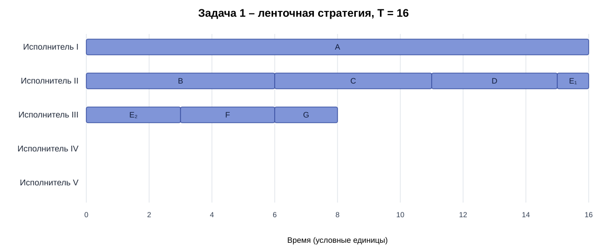
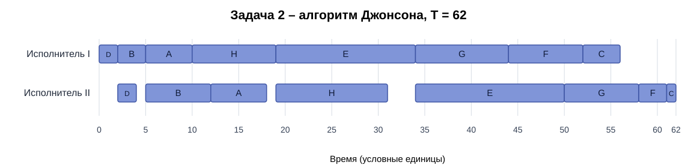

# Задание № 8 – команда void

## Вариант 4

## Задача 1. Ленточная стратегия

### 1. Постановка и выбор алгоритма

В первой задаче рассматриваем 7 независимых заданий разной длительности и 5 универсальных исполнителей. Прерывания разрешены. Каждый исполнитель может выполнить любое задание, но одно задание не может одновременно выполняться несколькими исполнителями. Требуется минимизировать время завершения всех заданий.

| Задание | A | B | C | D | E | F | G |
|:--|--:|--:|--:|--:|--:|--:|--:|
| Длительность | 16 | 6 | 5 | 4 | 4 | 3 | 2 |

Поскольку задания независимы, исполнители универсальны, а прерывания разрешены, выбираем ленточную стратегию, которую разбирали на семинаре № 11.

### 2. Оптимальная длительность

Суммарная трудоёмкость:

$$S=16+6+5+4+4+3+2=40.$$

Наибольшая длительность отдельного задания – $16$; средняя нагрузка на исполнителя – $40/5=8$.

$$T_{\mathrm{opt}} = \max\{16, 40/5\} = 16$$

Получить время меньше 16 не получится: задание A само по себе длится 16 единиц, а выполнять его несколькими исполнителями одновременно запрещено. Ленточная стратегия позволяет достигнуть этой границы.

### 3. Нарезка ленты

Сохраняем исходный порядок заданий: A, B, C, D, E, F, G. Переставлять задания не требуется.

Общая длина ленты – 40. Разрезаем её последовательно на фрагменты длины $T_{\mathrm{opt}}=16$; последний фрагмент может быть короче.

| Фрагмент ленты | Состав | Длина | Исполнитель |
|:--|:--|--:|:--|
| 1 | A(16) | 16 | I |
| 2 | B(6), C(5), D(4), первая по ленте часть E(1) | 16 | II |
| 3 | оставшаяся по ленте часть E(3), F(3), G(2) | 8 | III |

Итак, один разрез проходит внутри E: $E=1+3$. Исполнители IV и V не требуются: трёх достаточно, чтобы уложиться в 16 единиц.

Учитываем, что порядок фрагментов на ленте не обязательно совпадает с порядком их выполнения во времени. На исполнителе III часть E длиной 3 выполняется с 0 до 3, а на исполнителе II часть E длиной 1 – с 15 до 16. Части одного задания не пересекаются, поэтому запрет на одновременное выполнение одного задания несколькими исполнителями соблюдён.

### 4. Диаграмма Ганта

Временные интервалы по исполнителям:

- I: A [0, 16].
- II: B [0, 6], C [6, 11], D [11, 15], часть E длиной 1 [15, 16].
- III: часть E длиной 3 [0, 3], F [3, 6], G [6, 8]; далее простой [8, 16].
- IV и V: полностью свободны.

В момент 16 завершаются задание A на исполнителе I и часть задания E на исполнителе II. Следовательно, продолжительность построенного расписания равна $T_{\mathrm{opt}}=16$, а само расписание оптимально.

### 5. Интерпретация

Для интерпретации возьмём пакетную обработку независимых массивов телеметрии. Нам нужно проверить на ошибки семь независимых массивов данных A–G. Пять одинаково квалифицированных инженеров имеют доступ к одной системе обработки. Каждый массив имеет известную трудоёмкость; его можно сохранить в промежуточном состоянии, приостановить и затем передать любому инженеру без потери уже сделанной работы. Но одновременно один массив обрабатывает только один инженер: параллельная обработка разных частей одного массива системой не поддерживается. Цель – как можно раньше завершить проверку всех массивов. Длинный массив A занимает 16 единиц, поэтому даже пять инженеров не смогут завершить пакет быстрее 16 единиц. При этом достаточно задействовать троих, распределив остальные массивы ленточной стратегией.

---

## Задача 2. Алгоритм Джонсона

### 1. Постановка и выбор алгоритма

Во второй задаче рассматриваем 8 независимых заданий, каждое из которых состоит из двух последовательных этапов. Первый исполнитель выполняет только первый этап, второй – только второй. Прерывания запрещены. Этапы разных заданий могут идти одновременно на разных исполнителях, но второй этап задания нельзя начать раньше завершения первого. Требуется минимизировать время завершения всех заданий.

| Задание | A | B | C | D | E | F | G | H |
|:--|--:|--:|--:|--:|--:|--:|--:|--:|
| Первый этап $a_i$ | 5 | 3 | 4 | 2 | 15 | 8 | 10 | 9 |
| Второй этап $b_i$ | 6 | 7 | 1 | 2 | 16 | 3 | 8 | 12 |

Получаем двухэтапную конвейерную задачу с двумя специализированными исполнителями и без прерываний. Для её решения применяем алгоритм Джонсона, разобранный на семинаре № 11.

### 2. Алгоритм Джонсона: разбиение и сортировка

Шаг 1. Делим задания на две группы по сравнению длительностей этапов.

- Группа I, $a_i\le b_i$: A(5, 6), B(3, 7), D(2, 2), E(15, 16), H(9, 12).
- Группа II, $a_i>b_i$: C(4, 1), F(8, 3), G(10, 8).

У задания D длительности этапов равны, поэтому по правилу $a_i\le b_i$ относим его к первой группе.

Шаг 2. В группе I сортируем задания по возрастанию $a_i$:

$$D(2),\ B(3),\ A(5),\ H(9),\ E(15).$$

В группе II сортируем задания по убыванию $b_i$:

$$G(8),\ F(3),\ C(1).$$

Шаг 3. Объединяем группы: сначала I, затем II.

$$\boxed{D\to B\to A\to H\to E\to G\to F\to C}.$$

Так получаем оптимальный порядок по алгоритму Джонсона.

### 3. Построение расписания

На первом исполнителе задания выполняются в найденном порядке без простоев. Второй исполнитель начинает очередное задание, только когда выполнены оба условия: первый этап этого задания уже завершён и второй исполнитель освободился после предыдущего задания.

| Задание | Первый этап | Второй этап | Комментарий |
|:--|:--|:--|:--|
| D | [0, 2] | [2, 4] | Второй этап начинается после завершения первого в 2 |
| B | [2, 5] | [5, 12] | Второй исполнитель свободен с 4, но B готово только в 5 |
| A | [5, 10] | [12, 18] | A готово в 10, но второй исполнитель занят до 12 |
| H | [10, 19] | [19, 31] | Второй исполнитель свободен с 18, но H готово в 19 |
| E | [19, 34] | [34, 50] | Второй исполнитель свободен с 31, но E готово в 34 |
| G | [34, 44] | [50, 58] | G готово в 44, но второй исполнитель занят до 50 |
| F | [44, 52] | [58, 61] | F готово в 52, но второй исполнитель занят до 58 |
| C | [52, 56] | [61, 62] | C готово в 56, но второй исполнитель занят до 61 |

Проверка суммарной загрузки первого исполнителя:

$$2+3+5+9+15+10+8+4=56.$$

После завершения первого этапа C в момент 56 второй исполнитель ещё работает. Последний второй этап C заканчивается в момент 62.

### 4. Диаграмма Ганта

Временные значения на диаграмме – условные единицы. Суммарный простой второго исполнителя до завершения всех работ составляет $2+1+1+3=7$ единиц; остальные промежутки он занят.

Длительность полученного расписания: $\boxed{62}$ условные единицы. По алгоритму Джонсона полученный нами порядок оптимален для этой двухэтапной модели.

### 5. Интерпретация

В качестве интерпретации рассмотрим подготовку и испытание независимых партий экспериментальных электронных модулей. В лаборатории используем два специализированных стенда. Каждая из восьми партий A–H должна сначала пройти обязательную настройку на стенде I, а затем испытание на стенде II. Настройку и испытание выполняют разные специалисты; заменить друг друга они не могут. После настройки партия может ожидать свободного второго стенда, но испытание нельзя начать до окончания настройки. Начатую настройку или испытание прерывать нельзя: перезапуск процедуры потребовал бы повторного прохождения этапа. Одновременно два стенда могут работать с разными партиями. Задача лаборатории – завершить все партии как можно раньше. Порядок Джонсона позволяет закончить работы за 62 условные единицы времени.
