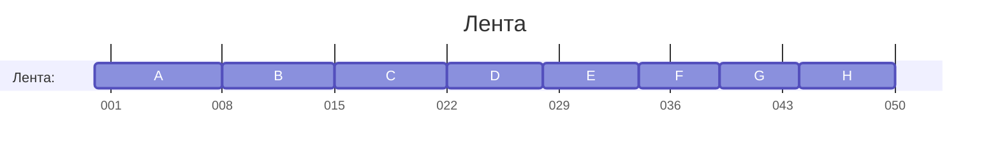
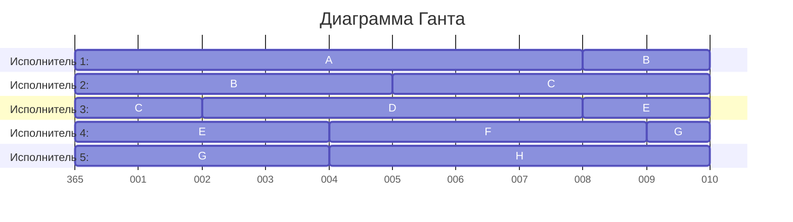
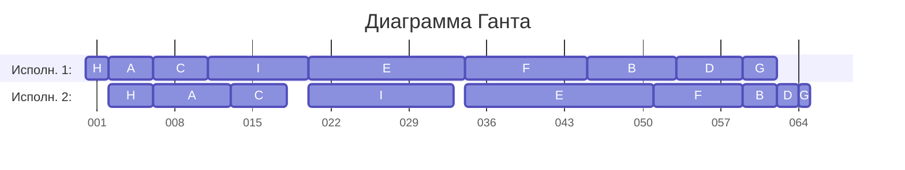

# №8. Вариант 8:

## Задача 1.
Имеется 8 независимых заданий и 5 универсальных исполнителей. Прерывания допускаются.

Длительности заданий:

| | $A$ | $B$ | $C$ | $D$ | $E$ | $F$ | $G$ | $H$ |
| --- | :---: | :---: | :---: | :---: | :---: | :---: | :---: | :---: |
| Длительность | 8 | 7 | 7 | 6 | 6 | 5 | 5 | 6 |

Постройте расписание выполнения всех заданий в кратчайшие сроки.

### Анализ постановки задачи:  
1. N-ное (произвольное) количество заданий;
2. Задания разной длительности;
3. Задания независимы;
4. Прерывания допускаются;
5. N-ное (произвольное) количество исполнителей;
6. Исполнители универсальны;
7. Исполнитель одинаковые по характеристикам;
8. Необходимо найти минимальную длительность выполнения всех заданий.

Таким образом, эту задачу следует решать используя _ленточную стратегию_.  

### Найдём оптимальное время:
Выберем максимум из длительностей всех заданий и средней загрузки (сумма всех длительностей, делённая на количество исполнителей):  

topt = max { 8, 7, 7, 6, 6, 5, 5, 6, $\frac{8+7+7+6+6+5+5+6}{5}$ = 10 }  

Дополнительно проверим условия:  
Сложим длительности заданий: 8 + 7 + 7 + 6 + 6 + 5 + 5 + 6 = 50.
Пять исполнителей выполнят этот объём не быстрее чем за 50 / 5 = 10 единиц времени. Кроме того, расписание не может быть короче самого длинного задания, которое занимает 8 единиц.

Таким образом, **topt = 10 - это длительность кратчайшего расписания**

_(Для отображения времени на ленте выбран формат "дни", поэтому отсечки могут находиться не ровно на границах длительностей заданий)_

Общая длина ленты равна 50. Разобьем ее на 5 частей длины 10.

Получаем следующие участки.

1. Исполнитель 1:
   - A - от 0 до 8;
   - часть B - от 8 до 10.

2. Исполнитель 2:
   - оставшаяся часть B - от 0 до 5;
   - часть C - от 5 до 10.

3. Исполнитель 3:
   - оставшаяся часть C - от 0 до 2;
   - D - от 2 до 8;
   - часть E - от 8 до 10.

4. Исполнитель 4:
   - оставшаяся часть E - от 0 до 4;
   - F - от 4 до 9;
   - часть G - от 9 до 10.

5. Исполнитель 5:
   - оставшаяся часть G - от 0 до 4;
   - H - от 4 до 10.

Части одного задания не выполняются одновременно!

### Составим диаграмму Ганта:

_(Для отображения времени на ленте выбран формат "дни", поэтому отсчёт ведётся не с 0 (нулевого дня), а с последнего дня предыдущего года (он под номером 365))_  

### Ответ и интерпретация заданных условий: 
Длительность кратчайшего расписания = 10.  

**Эту задачу наша команда интерпретировала так: пять аналитиков размечают восемь демозаписей матчей CS2. Разные записи можно разбирать независимо. Одну запись в каждый момент смотрит только один аналитик, но её можно поставить на паузу и передать другому вместе с сохранённой позицией. Для этой модели считаем, что аналитики работают с одинаковой скоростью, а передача записи времени не занимает.**  

  
## Задача 2.
Имеется 9 независимых заданий, каждое из которых состоит из двух последовательных этапов, и 2 исполнителя: первый выполняет только первый этап каждого задания, второй — только второй. Прерывания запрещены.

Длительности этапов:

| | $A$ | $B$ | $C$ | $D$ | $E$ | $F$ | $G$ | $H$ | $I$ |
| --- | :---: | :---: | :---: | :---: | :---: | :---: | :---: | :---: | :---: |
| Первый этап | 4 | 8 | 5 | 6 | 14 | 11 | 3 | 2 | 9 |
| Второй этап | 7 | 3 | 5 | 2 | 17 | 8 | 1 | 4 | 13 |

Постройте расписание выполнения всех заданий в кратчайшие сроки.

### Анализ постановки задачи:  
1. N-ное (произвольное) количество заданий;
2. Задания разной длительности;
3. Задания независимы;
4. Прерывания НЕ допускаются;
5. Два исполнителя;
6. Исполнители НЕ универсальны;
7. Исполнитель одинаковые по характеристикам;
8. Необходимо найти минимальную длительность выполнения всех заданий.

Таким образом, это _конвейерная задача_. Решим её с помощью алгоритма Джонсона.

### Распределим задания в группы:
Создадим две группы по соотношению первого и второго этапов. В первую группу отнесём те задания, где первый этап короче второго или равен ему; во вторую группу - оставшиеся.  
Так, получим группы:  
1. A, C, E, H, I.
2. B, D, F, G.

### Отсортируем задания в группах:
Группу 1 отсортируем в порядке возрастания первого этапа (делаем это для того, чтобы простой второго исполнителя в начале был минимальным).  
Получим:  

1. H (2), A (4), C (5), I (9), E (14).

Группу 1 отсортируем в порядке убывания второго этапа.  
Получим:  

2. F (8), B (3), D (2), G (1).

### Объединим отсортированные списки:
Получаем оптимальный порядок выполнения заданий:  
H → A → C → I → E → F → B → D → G.  

### Построим расписание
Первый исполнитель выполняет задания последовательно в найденном порядке без простоев.  
Второй исполнитель может начать второй этап очередного задания только после выполнения двух условий:
- первый этап этого задания завершен;
- второй исполнитель завершил предыдущее задание.  

Так, начало второго этапа определяется как максимум из момента окончания первого этапа текущего задания и момента освобождения второго исполнителя.

| Задание | 1-й этап, начало | 1-й этап, конец | 2-й этап, начало | 2-й этап, конец |
| --- | ---: | ---: | ---: | ---: |
| H | 0 | 2 | 2 | 6 |
| A | 2 | 6 | 6 | 13 |
| C | 6 | 11 | 13 | 18 |
| I | 11 | 20 | 20 | 33 |
| E | 20 | 34 | 34 | 51 |
| F | 34 | 45 | 51 | 59 |
| B | 45 | 53 | 59 | 62 |
| D | 53 | 59 | 62 | 64 |
| G | 59 | 62 | 64 | 65 |

Как видим, **длительность кратчайшего расписания = 65.**

### Составим диаграмму Ганта:

_(Для отображения времени на ленте выбран формат "дни", поэтому отсечки могут находиться не ровно на границах длительностей заданий)_

### Ответ и интерпретация заданных условий: 
Длительность кратчайшего расписания = 65.    

**Эту задачу наша команда интерпретировала так: перед выездной игрой готовят девять комплектов раций. На первом стенде записывают настройки, на втором проверяют работу каждого комплекта. Проверка начинается только после записи настроек, но первый стенд в это время уже может готовить следующий комплект. Операции не прерываются, между стендами комплекты могут ждать. Считаем, что все комплекты доступны с начала работы, а перенос и переналадка времени не занимают.**

Дополнительный пример (со станком): Первый специализированный станок выполняет подготовку и нанесение проводящего рисунка. После завершения этой операции заказ передается на второй станок, где выполняются контроль и финишная обработка. Каждый станок одновременно обрабатывает только один заказ, а прерывать начатую операцию нельзя.